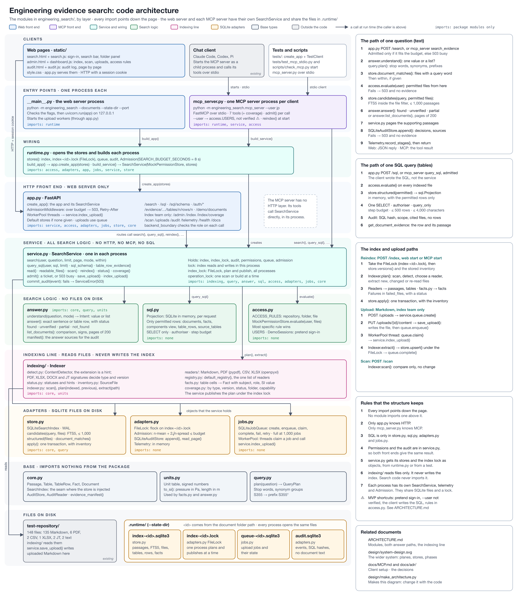

# Architecture

This document describes the code as it runs now. [design/SYSTEM-DESIGN.md](design/SYSTEM-DESIGN.md) describes the wider design and the phases. [design/EXTRACTION.md](design/EXTRACTION.md) describes how extraction and the stores must grow.

## Overview



Source: [design/code-architecture.svg](design/code-architecture.svg), made by [design/make_architecture.py](design/make_architecture.py). Change the script when a module or an import changes. [design/system-design.png](design/system-design.png) shows the wider system and the phases.

The diagram shows the modules by layer. Every import points down the page. There are two processes: the web server (`python -m engineering_search`) and the MCP server, which the chat client starts. Each process has its own `SearchService`. They share the SQLite files in the state folder. The diagram was drawn before the [indexing package](#the-indexing-line) was added: it still shows file reading in `core.py`.

## Two lines: indexing and searching

The service does two separate jobs. They meet only at the index.

| Line | What it does | Code |
| --- | --- | --- |
| **Indexing** | Find every file in the document folder, detect its type, read the files that have a reader, and plan the changes to the index | [`engineering_search/indexing/`](engineering_search/indexing/): `Indexer`. `SearchService.scan`, `reindex` and the upload workers call it, and `SearchService` publishes its plan |
| **Searching** | Change a question into an index query, look it up, check permissions, select the answer, audit and return | [`query.py`](engineering_search/query.py), [`answer.py`](engineering_search/answer.py), the lookups in [`store.py`](engineering_search/store.py), and `SearchService.search` |

The index ([`store.py`](engineering_search/store.py)) is shared: indexing writes it through `SearchService`, and searching reads it. The indexing package does not import the store, the service or the web app, and nothing on the search line imports the indexing package.

## The path of one question (the searching line)

[`SearchService.search`](engineering_search/service.py) does these steps in this order. The web page, the HTTP API and the MCP server all call it.

1. **Understand.** [`answer.understand`](engineering_search/answer.py) decides if the question asks for one value or for a list of documents. It also finds a number comparison, for example "greater than 5 kN/m²".
2. **Plan.** [`query.plan`](engineering_search/query.py) removes common words, adds synonyms, and makes words with digits into prefix searches.
3. **Look up.** [`SQLiteSearchIndex.candidates`](engineering_search/store.py) runs the FTS5 query and returns up to 1,000 passages, best first, from all files. The service then removes passages outside `within`, if it is given. For a list question, `document_matches` also finds the documents that contain every word.
4. **Check permissions.** [`MockPermissionStore.evaluate`](engineering_search/access.py) decides which of the matched files the user may read. Everything after this step uses only permitted files. **Known defect:** the 1,000-passage limit in step 3 applies before this step and before `within`. See [Known defects](#known-defects).
5. **Answer.** [`answer.answer`](engineering_search/answer.py) reads the 8 best permitted passages and selects one sentence or table row. [`answer.list_documents`](engineering_search/answer.py) reads every passage of each matching document, applies the number comparison, and returns at most 200 documents.
6. **Page.** The supporting passages are paged. The document list of a list answer is not paged: each page returns the same list.
7. **Audit.** The audit event is written. It holds the permission decision for each file and the source of the answer and of each passage. If the write fails, the user gets no evidence.
8. **Return.** The response holds `answer`, `evidence`, `searched_for`, counts and paging fields.

## Modules

| Module | Responsibility |
| --- | --- |
| [`indexing/`](engineering_search/indexing/) | The indexing line. `detect.py` (file type detection), `inventory.py` (the files of a scan, with type and outcome), `readers.py` (Markdown and PDF readers), `indexer.py` (`Indexer`: scan, plan, extract) |
| [`core.py`](engineering_search/core.py) | Defines `Passage`, `Document` and the `SearchIndex` and `AuditStore` interfaces |
| [`store.py`](engineering_search/store.py) | `SQLiteSearchIndex`: the documents, passages and FTS5 tables. Changes are applied in one transaction |
| [`query.py`](engineering_search/query.py) | Changes a question into an index query: stop words, synonyms, prefix terms |
| [`answer.py`](engineering_search/answer.py) | Selects the answer text, makes document lists, compares numbers with unit conversion |
| [`access.py`](engineering_search/access.py) | Pretend users, path-based access rules, sessions. The access assumptions are at the top of the file |
| [`service.py`](engineering_search/service.py) | `SearchService`: search, read a file, reindex, scan, status and upload publish. It calls the `Indexer` and publishes its plans to the index under its locks. The web app and the MCP server share it. It has no web code |
| [`app.py`](engineering_search/app.py) | The web app: HTTP routes, pretend sign-in, the index-team boundary, uploads and the web pages. It changes requests into `SearchService` calls |
| [`mcp_server.py`](engineering_search/mcp_server.py) | The MCP server (stdio) with `search_evidence` and `read_evidence`. It uses `SearchService` directly, without the web app |
| [`runtime.py`](engineering_search/runtime.py) | Opens the index, queue and audit files in the state folder. Builds the web app or the service alone |
| [`jobs.py`](engineering_search/jobs.py) | The SQLite upload queue and the worker threads |
| [`adapters.py`](engineering_search/adapters.py) | The SQLite audit store and the in-memory telemetry |
| [`static/`](engineering_search/static/) | The web pages: `search.html` (with the sign-in screen), `admin.html` (index operations) and `audit.html` (audit log) |

Every import points down the layers of the diagram:

- `__main__.py` imports `runtime.py`. `mcp_server.py` imports `runtime.py`, `service.py` and `access.py`.
- `runtime.py` imports `app.py`, `service.py` and the stores. It opens the SQLite files and gives them to the service as objects.
- `app.py` imports `service.py`, `access.py`, `adapters.py`, `jobs.py`, `store.py` and `core.py`. It imports the stores only to make defaults when none are given (the tests do this, with an in-memory index).
- `service.py` imports `indexing/`, `query.py`, `answer.py`, `access.py`, `adapters.py`, `jobs.py` and `core.py`. It does not import `store.py`: it gets the index as an object.
- `indexing/` imports only `core.py`.
- `answer.py` and `store.py` import `core.py` and `query.py`. `core.py`, `query.py`, `access.py`, `adapters.py` and `jobs.py` import nothing from the package.

Only `app.py` knows HTTP. Only `mcp_server.py` knows MCP. SQL is only in `store.py`, `adapters.py` and `jobs.py`.

## The indexing line

All of it is in [`engineering_search/indexing/`](engineering_search/indexing/). [`tests/test_indexer.py`](tests/test_indexer.py) tests it with a folder only: no web app, no index database and no queue.

```text
Indexer.scan()          every file → detect type → read and hash if a reader exists → Inventory
Indexer.plan(indexed)   scan, compare with the indexed versions, extract new and changed files → IndexPlan
SearchService           index.apply(plan.upserts, plan.removals), in one transaction, under its locks
```

### 1. Detect the file type

[`ExtensionDetector`](engineering_search/indexing/detect.py) names the type of each file from its extension, in any case: `.md` is `markdown`, `.pdf` is `pdf`. It also names types that have no reader, for example `.txt` (`text`), `.docx`, `.dwg`, `.dxf`, `.jt`, CATIA and `.ifc`. Any other extension is `unknown`. Detection does not read the file.

A detector is any object with `detect(path) -> str` (the `Detector` protocol). A later detector can read the first bytes of the file with libmagic, and find the format version ([ADR 0003](docs/adr/0003-versioned-reader-selection.md)). Pass it as `Indexer(root, detector=...)`. Nothing else changes.

### 2. Scan into an inventory

[`Indexer.scan`](engineering_search/indexing/indexer.py) lists every regular file below the document folder. It does not follow symbolic links, and it skips hidden files and folders (names that start with `.`). An unreadable folder fails the scan. Each file gets one outcome ([`inventory.py`](engineering_search/indexing/inventory.py)):

| Outcome | Meaning |
| --- | --- |
| `indexable` | A reader exists for the type. The bytes were read and hashed (SHA-256) |
| `unsupported` | No reader for the type. The file is listed with its type and size, and is not read |
| `unreadable` | A reader exists, but the file could not be read (for example, `PermissionError`) |

The inventory is held in memory by `SearchService` until the next scan. It is not stored in the index. `/index/status` and the index operations page show the type of each file, the count of each type (`file_types`), and the `unsupported` and `unreadable` files. These files are not pending changes.

### 3. Read the files that have a reader

[`readers.py`](engineering_search/indexing/readers.py) maps each file type to a reader. A reader takes the bytes of one file and returns its passages. Only `markdown` and `pdf` have readers.

- **Markdown:** the reader splits the UTF-8 text at headings and blank lines. It does not split inside code fences. Line numbers are lines of the file.
- **PDF:** the reader uses pypdf to get the text layer of each page. It splits each page at numbered headings (for example "3.1 Roof load limit") and blank lines. A passage has at most 15 lines. Line numbers are lines of the page text, and each passage has its page number.

### 4. Plan the index changes

[`Indexer.plan`](engineering_search/indexing/indexer.py) takes the versions that are in the index now (file ID → SHA-256). It extracts only the indexable files whose version is new or changed. It returns an `IndexPlan`: the documents to write, the file IDs to remove, the versions after publish, and the failed files. The indexer never writes the index.

If a file cannot be read or extracted (for example, `PermissionError`, invalid UTF-8 or a damaged PDF), the plan skips it and reports it in `failed_files`. The other files are indexed. A failed file is removed from the index, so an old version is not kept as if it were current.

One case is not handled: **a PDF with no text layer** (for example, a scan) is indexed with zero passages and is not in `failed_files`. The index status can show `up_to_date`. The service does not report that the file is not searchable.

Uploads use the same component: the upload workers call `Indexer.extract` for one file.

## The index

The index is one SQLite file, `<state-dir>/index-<id>.sqlite3`.

| Table | Contents |
| --- | --- |
| `documents` | One row for each file: path, SHA-256 version, passage count |
| `passages` | The exact passage text, heading, line range and page |
| `passages_fts` | The FTS5 inverted index of each passage's heading, text and file-path words. It uses the `porter unicode61` tokenizer, so "loads" matches "load" |
| `meta` | The time of the last change |

A rebuild runs the [indexing line](#the-indexing-line): it reads the bytes of every indexable file and computes its SHA-256. It extracts passages only from new and changed files, and removes deleted files. `read_files` in the index result counts the extracted files, not the files that were read and hashed. All changes are applied in one transaction. If the transaction fails, the old index stays.

The ranking:

1. Passages that contain more of the query words come first. Words in the heading or the file path count.
2. Then BM25, with weights 3 for the heading, 1 for the text and 0.5 for the file path.

## Permissions

All files are indexed. Permissions decide what each user sees. See the assumptions at the top of [`access.py`](engineering_search/access.py).

- A rule applies to the whole repository, to a folder, or to one file. The most specific rule wins.
- The service checks permissions on each request, after the index lookup and before it selects the answer, counts results or pages them.
- A response contains no name, text or count of files that the user cannot read. But the index lookup is limited to 1,000 passages before the permission check. Forbidden passages that rank higher can push permitted passages out of the result, so a user can get fewer results or `not_found`. This loses permitted evidence, and forbidden files can change what a user sees. See [Known defects](#known-defects).
- The audit log records each decision. Only the index team (Maya) can read it.

## Answers and sources

An answer is always text copied from one passage. It has the file, page, line range and file version of that passage. The acceptance tests in [`tests/test_use_case.py`](tests/test_use_case.py) check each answer against the file itself.

The source proves where the text is. It does not prove that the text answers the question. The status `found` means that the selected sentence states a value, and that the whole document contains every question word somewhere. It does not check that the question words describe that value. For example, in a document with "Roof load is not specified. Floor load limit is 5 kN/m².", the question "What is the roof load?" gets the floor load sentence with status `found`.

The service does not make text or choose between documents that disagree. It shows up to five other documents that state a value, taken from the 8 best passages, so the user can see some conflicts. This is not every value in the repository.

Number comparisons convert units, but the quantity pattern does not read signs. "Roof load -2 kN/m²" is read as 2 kN/m².

## What runs where

| Process | Started by | Contents |
| --- | --- | --- |
| Web service | `python -m engineering_search` | FastAPI app, upload workers, startup index |
| MCP server | The chat client (`python -m engineering_search.mcp_server`) | A `SearchService` only. No web app, no upload workers |

Both processes can use the same state folder. They then share the index and the audit log. SQLite WAL mode and a 30-second lock timeout let them write in turn, so no write is half applied.

But the locks that stop two index refreshes at the same time (`SearchService.lock` and `operation_lock`) are in each process. Nothing coordinates the two processes. If both refresh at the same time, the slower one can publish an older version of a file over a newer one. Both processes refresh the index when they start. Until this is fixed, do not start the web service and the MCP server at the same time on one state folder, and do not reindex from `/admin` while the MCP server starts.

## MVP shortcuts in the code

The MVP takes these shortcuts on purpose, to deliver quickly. Each one is acceptable for a local demonstration with 138 files. Each one must change before a shared service. [TODO.md](TODO.md) gives the gaps and the next work.

| Area | Shortcut | Effect | Change before a shared service |
| --- | --- | --- | --- |
| Identity | Pretend sign-in. Sessions are in memory. The MCP server takes the user from `--user` | Anyone can act as any user. Sessions end when the service stops. The MCP identity is a security hole | Company sign-in (OAuth). User from a verified token |
| Permissions | Access rules are a Python dictionary in `access.py` | A change needs a code change. No groups or deny rules | Read the permissions from the repository |
| Concurrency | One lock (`SearchService.lock`) in each process protects the index and the state. A search holds it from the index lookup to the audit write | Searches run one at a time in a process. A search waits while an index commit runs. Two processes are not coordinated (see [Known defects](#known-defects)) | Read-only searches without a global lock, on a server index. Index publication that rejects stale work |
| Uploads | The upload routes in `app.py` call `service.queue` directly to create, read, fail and retry jobs. Only saving and indexing go through `SearchService` | Upload logic is in two modules. The MCP server cannot upload | Move the job steps into `SearchService` if another front end needs uploads |
| Errors | `ServiceError` carries an HTTP status code, also in the service | Simple: the web app returns the status, the MCP server returns the message. The service knows HTTP status numbers | Acceptable. Use named error types if more callers come |
| Index state | The last scan and the index state are in memory | After a restart, the index operations page shows "not scanned" until the next scan | Store the state with the index |
| Telemetry | In memory | Resets when the service stops | A metrics system |
| File types | `ExtensionDetector` names the type from the file extension. The type selects the reader (`markdown` or `pdf`) | A damaged or misnamed file is found only when its reader fails. The format version is not known | A detector that reads the content (libmagic) and the format version ([ADR 0003](docs/adr/0003-versioned-reader-selection.md)) |
| Inventory | The scan inventory (types and outcomes) is in memory | After a restart, the file types are not known until the next scan | Store the inventory with the index |
| Query words | Stop words and synonyms are lists in `query.py` | Changes need a code change. The lists fit the test questions | A parameter dictionary that engineers maintain |
| Answer rules | Value patterns and units are regular expressions in `answer.py` | They fit the test documents. Other notations are missed | Index-time facts store ([design/EXTRACTION.md](design/EXTRACTION.md)) |
| List answers | A list question reads all passages of each matching document from SQLite. At most 200 documents are returned, and the list is not paged | Fast for 138 files. Slow for many thousands of matches. Documents after the first 200 cannot be retrieved | Facts and metadata in the index, with filters in the query. Page the document list |
| Web pages | Plain HTML and JavaScript, no framework, no build step. Checked by eye | No automated web page tests | Add browser tests if the pages stay |
| Uploads | Markdown only, 10 MiB, local worker threads | No PDF upload. Workers stop with the service | A shared queue and workers ([design/SCALING.md](design/SCALING.md)) |
| Storage | SQLite files in one state folder, shared by the web service and the MCP server | One machine. Writers take turns | A server database or search engine |

## Known defects

These are errors in the code, not shortcuts. They were found in an independent review on 2026-10-28 and reproduced. They are not fixed. The test suite does not detect them. [TODO.md](TODO.md#known-defects-fix-first) tracks the fixes.

| Defect | Effect | Code |
| --- | --- | --- |
| The answer status checks words against the whole document, not against the selected value | A wrong parameter can be returned with status `found`. A list comparison can qualify a document by the value of a different element, for example a floor load of 10 kN/m² for "roof load greater than 5 kN/m²" | [`answer.answer`](engineering_search/answer.py), [`answer.list_documents`](engineering_search/answer.py) |
| The index lookup is limited to 1,000 passages before permissions and `within` are applied | Permitted evidence can be lost. Adding forbidden files can change a user's result to `not_found`. `within` cannot recover a file that fell outside the limit | [`store.py`](engineering_search/store.py) `CANDIDATE_LIMIT`, [`service.py`](engineering_search/service.py) `search` |
| Number comparisons ignore a minus sign | "-2 kN/m²" is read as 2 kN/m² and can meet "greater than 1 kN/m²" | [`answer.py`](engineering_search/answer.py) `QUANTITY` |
| A list answer returns at most 200 documents, and `page` does not page it | `count` and `truncated` are correct, but the other documents cannot be retrieved. A follow-up with `within` uses only the 200 returned | [`answer.py`](engineering_search/answer.py) `MAX_LISTED` |
| Index refreshes in two processes are not coordinated | An older version of a file can overwrite a newer one in the shared index | [`service.py`](engineering_search/service.py) `SearchService.__init__` and `reindex` |
| A PDF without a text layer is counted as indexed | Coverage looks better than it is, and "not found" is ambiguous | [`indexing/readers.py`](engineering_search/indexing/readers.py) `read_pdf` |

Fixed since the review: a file read error no longer stops the whole index refresh. The indexer reports the file as `unreadable` in `failed_files` and indexes the others ([`tests/test_indexer.py`](tests/test_indexer.py)).
