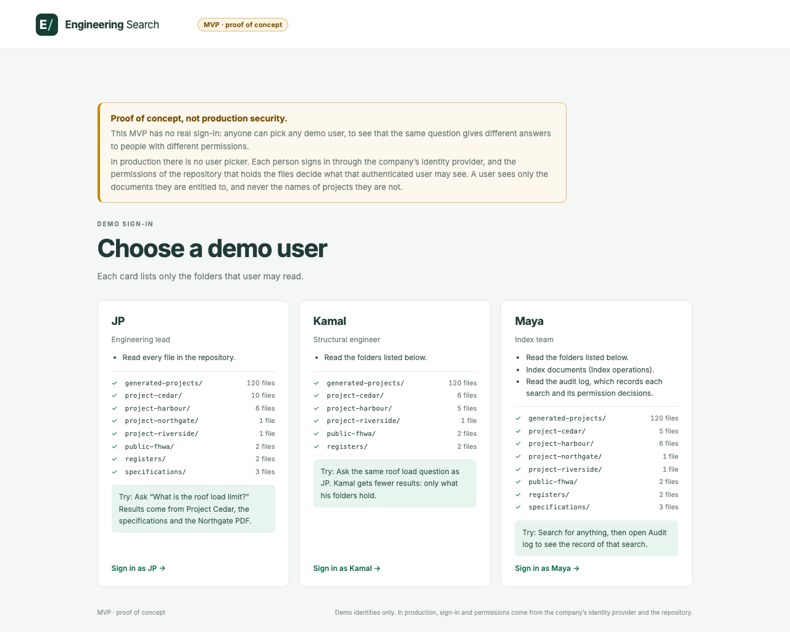
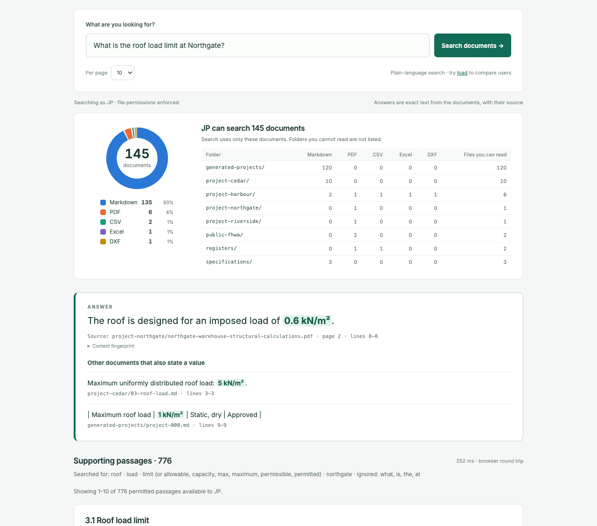
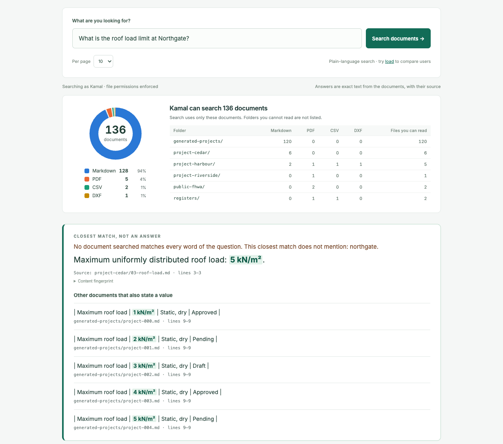
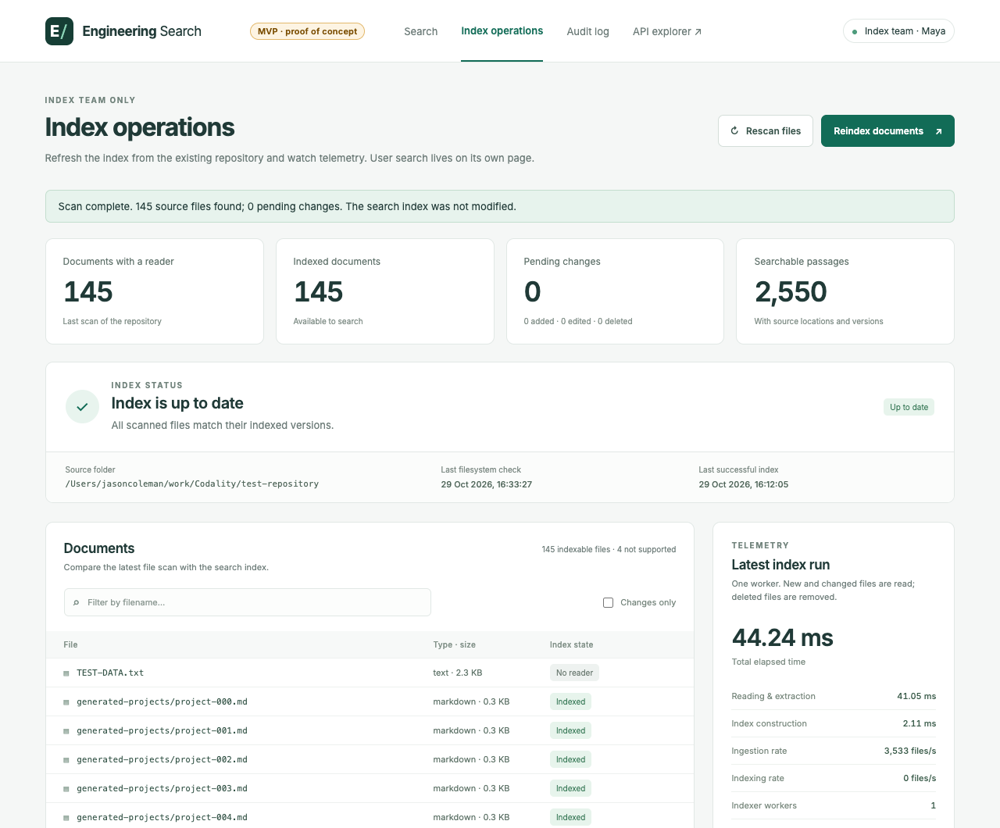
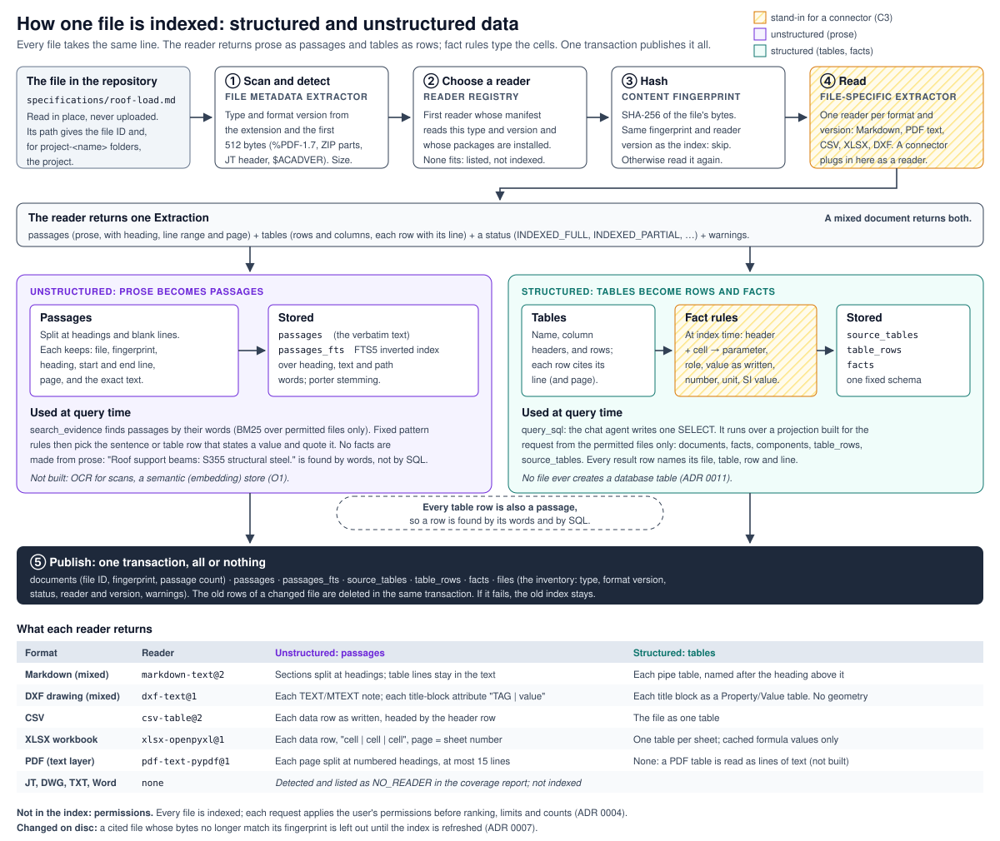

# Engineering evidence search (MVP)

This is a local evidence-search prototype, built to prove one use case from [the brief](docs/Starting_document.md): a selected engineering manager or lead finds a critical engineering parameter across 100+ project documents in under 10 seconds, with 100% confidence in the source, without opening a CAD file or a PDF viewer. It answers questions about engineering values from a document repository, and cites the exact source of each value. It selects answers with fixed rules, not with a language model, and it was measured only on a curated test repository. Read [Known limits](#known-limits) before you rely on a result. It is an MVP built in about four to five hours to answer one question under a set of constraints, not a platform: [docs/README.md](docs/README.md) says what it proves, what it does not, and why making it available to a whole organisation is its own engineering challenge.

**On one page:** open [ONE-PAGER.html](ONE-PAGER.html) in a browser. It shows the brief, the system, and the journey of one file through it: indexed and hashed, read into passages and a table, found by one user, invisible to another, edited, and indexed again. The values in it are what the code returned.

## What it looks like

The screenshots are of the web search page, the test harness that stands in for a chat-agent shell. The same search service sits behind the MCP server.

**Sign-in.** Anyone can pick a demo user. Each card names only the folders that user may read.



**JP, an engineering lead, asks "What is the roof load limit at Northgate?"** The panel shows the documents JP may search. The answer is the exact sentence from the Northgate PDF, with the file, the page, the lines and the content fingerprint. Other documents that state a value are listed under it.



**Kamal, a structural engineer, asks the same question.** Kamal may not read `project-northgate/`, so the PDF is not searched and not counted. The best permitted passage does not mention Northgate, so it is shown as the closest match, not as an answer.



**Maya, the index team, sees index operations:** the files with a reader, the indexed documents, pending changes, the passages, and the latest index run.



**How one file is indexed.** Prose becomes passages in a full-text index; tables become rows and typed facts. [design/INDEXING.md](design/INDEXING.md) explains it step by step.



## The premise: know the questions and the data first

To build an indexer, you need an idea of the questions that people will ask. To answer those questions, you need to know what data you have and what you can extract from it. That leads to two broad kinds of extracted data, and this service keeps both:

- **Unstructured: text.** Sentences and table rows, in an inverted keyword index. Good for "What is the roof load limit at Northgate?": find the sentence that states the value, and quote it.
- **Structured: tables and typed facts.** Rows and columns read from schedules and registers, and typed values with a unit, a subject and a role. Good for "Which S355 components have an allowable load under 5 kN/m²?": a filter and a comparison over many rows, which keyword search cannot do reliably.

A chat agent uses both through one MCP server. For the structured kind, **the agent writes the SQL**: it reads the schema, writes one `SELECT`, and the service runs it under tight limits, against only the rows that the user may read. The service never trusts the SQL; it constrains it.

## Two ways to answer

| | Unstructured (text) | Structured (tables and facts) |
| --- | --- | --- |
| Question | "What is the roof load limit at Northgate?" | "Which S355 components have an allowable load under 5 kN/m²?" |
| Extracted at index time | Passages: headings, sentences, table rows, with line numbers | Tables, rows and typed facts, with line numbers |
| Who forms the query | The service: words, synonyms, a value comparison | The MCP client (Claude Code, Codex, Pi) writes one SQL `SELECT` |
| Where it runs | SQLite FTS5 index, then rule-based answer selection | A per-request, read-only, in-memory SQLite projection |
| Answer | One quoted sentence, or a list of documents with the qualifying line | Rows, each with file, line and page |
| Proof of source | File, page, lines, the quoted text, and the file's content fingerprint (SHA-256); a file changed since indexing is refused | The same, plus `get_document_evidence` for the exact row and passage |
| Tool | `search_evidence` | `describe_schema`, `query_sql`, `get_document_evidence` |

Both ways use one search service, one index, one set of permissions and one audit log.

### Example: the structured question

The agent calls `describe_schema`, then runs:

```sql
SELECT subject, project, material_grade, allowable_load_kn_m2, compliance_status, file_id, line
FROM components
WHERE material_grade LIKE 'S355%' AND allowable_load_kn_m2 < 5
```

As JP, this returns seven rows from four files, for example `B-104 · Harbour · S355J2 · 4.5 kN/m² · Approved · project-harbour/harbour-component-schedule.csv, line 3`. As Kamal it returns six: the roof schedule (`R-310`) is in a file that Kamal may not read, so it is not in Kamal's projection at all. The slab `F-021` (3.2 kN/m²) is not returned, because 3.2 is an imposed load (a demand), not an allowable load (a capacity).

Claude Code, Codex and Pi each answered this question over local stdio, with citations. [docs/MCP.md](docs/MCP.md) gives the setup for each client and what each one returned.

## Contents of the repository

| Folder or file | Contents |
| --- | --- |
| `engineering_search/` | The service: search, SQL, permissions, audit, web pages and the MCP server |
| `engineering_search/indexing/` | The indexing line: content detection, readers and their registry, facts, the inventory, coverage |
| `test-repository/` | Test documents only (149 files). See `test-repository/TEST-DATA.txt` |
| `evaluation/` | Test questions, saved scores, and [what they mean](evaluation/README.md) |
| `scripts/` | Scoring, fixture generation, the MCP check, packaging and benchmark scripts |
| `tests/` | Automated tests, including the leak test and a real stdio MCP client test |
| `design/` | System design, extraction design and diagrams |
| `docs/` | [What the MVP is and is not](docs/README.md), [the brief item by item](docs/constraints/README.md), [the decision records](docs/adr/README.md), MCP setup, metrics, and two dated design inputs |
| `.mcp.json`, `.pi/mcp.json` | Project MCP configuration for Claude Code (the search server) and Pi |
| `AGENTS.md` | The routine for coding agents: test before every commit, no tautological tests |

Other documents:

- [RUNNING.md](RUNNING.md): how to install and run the service.
- [docs/MCP.md](docs/MCP.md): how to connect Claude Code, Codex and Pi, and what to ask.
- [ARCHITECTURE.md](ARCHITECTURE.md): how the code works.
- [ONE-PAGER.html](ONE-PAGER.html): the brief, the system and the journey of one file, on one page.
- [design/INDEXING.md](design/INDEXING.md): exactly how structured and unstructured data are indexed, with an infographic.
- [design/EXTRACTION.md](design/EXTRACTION.md): which questions need which extracted data, and how it is extracted.
- [design/SYSTEM-DESIGN.md](design/SYSTEM-DESIGN.md): the proposed design. It separates what is built from what is proposed.
- [design/DATA-PROFILE.md](design/DATA-PROFILE.md): why the profile of the real repository must come first.
- [docs/METRICS.md](docs/METRICS.md) and [evaluation/README.md](evaluation/README.md): the scores and their limits.
- [TODO.md](TODO.md): what is done, the gaps, and the next work.
- [GLOSSARY.md](GLOSSARY.md): the terms these documents use.
- [The brief, item by item](docs/constraints/README.md): background, constraints, use case, task and scope, the clarifications, and the [gaps and challenges](docs/constraints/gaps.md).
- The [decision records](docs/adr/README.md). [ADR 0001](docs/adr/0001-prove-the-use-case-with-stand-in-readers.md) records why the readers are stand-ins; [ADR 0006](docs/adr/0006-the-user-never-writes-sql.md) why the user never writes SQL and the chat agent may.
- A design input, dated 29 October 2026 and kept unchanged: [the design notes](docs/engineering_knowledge_search_design_notes.html).

## Quick start

You need Python 3.11 or later and `uv`.

```bash
uv sync --locked
```

```bash
uv run --frozen python -m engineering_search
```

Then open <http://127.0.0.1:8000/search> and select a demo user. The service indexes `test-repository/` when it starts and keeps the index in `.runtime/`.

To check the MCP server without a chat client:

```bash
uv run --frozen python -m scripts.check_mcp --user kamal
```

## How indexing works

Indexing and searching are two lines that meet only at the store. The indexing line is in [`engineering_search/indexing/`](engineering_search/indexing/).

1. **Scan.** List every file in the document folder. Skip symbolic links and hidden files.
2. **Detect the type from the content.** The extension is a hint. Formats with a signature are checked against the first bytes: `%PDF-1.7` gives PDF version 1.7, a ZIP with `xl/workbook.xml` is XLSX, and a JT file's 80-character header gives its version (for example JT 10.0). If the content contradicts the extension, the status is `FORMAT_MISMATCH`, and the file is not given to a reader. The JT probe reads the version string only. It is not a JT reader.
3. **Choose a reader.** Each reader declares a manifest: the file types and format versions it is tested with, what it can extract (text, tables), and the Python packages it needs. The registry (`default_registry()` in [`readers/registry.py`](engineering_search/indexing/readers/registry.py)) is the one list of readers. It tells apart "no reader for this type" (`NO_READER`), "no reader for this version" (`UNSUPPORTED_VERSION`) and "the reader's package is not installed" (`DEPENDENCY_MISSING`).
4. **Read.** The readers are sample stand-ins for the connectors that the brief says already exist ([ADR 0001](docs/adr/0001-prove-the-use-case-with-stand-in-readers.md)): Markdown (text and pipe tables), PDF (text layer, with `pypdf`), CSV, XLSX (with `openpyxl`), and DXF drawings (the notes and the title-block attributes, never the geometry). A reader returns passages, tables and a status: `INDEXED_FULL`, `INDEXED_PARTIAL` (for example, PDF pages without text, or a formula without a cached value), `NO_TEXT_LAYER` (a scan) or `NO_EXTRACTABLE_CONTENT`. A file the reader rejects is `MALFORMED`, `ENCRYPTED` or `UNSUPPORTED_VERSION` (for example a binary DXF); any other reader error is `READER_CRASH`. One bad file never stops the others.
5. **Extract facts.** Fixed rules turn table cells into typed facts. See [Structured data](#structured-data-tables-and-facts).
6. **Publish.** Every file is hashed (SHA-256, its content fingerprint); only new and changed files are read, and files whose reader changed; files deleted from the repository are removed. The refresh runs when the service starts and when the index team asks; there are no uploads, because the files live in the existing repository. The service publishes the passages, tables, facts and the inventory in one transaction, under a lock that other processes on the same index also respect.

The index team sees the result in the **coverage report** (`GET /index/coverage`, or the MCP tool `get_index_coverage`): files by type and version, by status, by folder and by capability, and each file that was not fully read, with the reason and a hint. On `test-repository/` it reports 143 files fully read (including the DXF drawing), 1 partly read (the roof schedule's formula), 1 scan with no text layer, a synthetic JT 10.0 header with no reader, a mislabelled `.jt` file, and two `.txt` files with no reader.

## Structured data: tables and facts

**What is extracted.** Markdown pipe tables, CSV files, XLSX sheets and DXF title blocks become tables, with the line (or sheet row) of each row. A table is rows in the store's fixed tables, never a database table of its own ([ADR 0011](docs/adr/0011-tables-land-in-one-fixed-schema.md)). Facts come only from table cells, never from free text. Each fact has:

- a **subject**: what the row is about, for example `B-104`;
- a **parameter** from a small controlled list: `material_grade`, `allowable_distributed_load`, `load_capacity`, `roof_imposed_load`, `imposed_load`, `applied_load`, `settlement`, `deflection`, `compliance_status`, or the column name for other quantities;
- a **role**: `capacity`, `demand`, `specification`, `status`, `measurement` or `unknown`. Capacity and demand are never the same parameter;
- the **value as written**, the parsed number with its sign, the unit, and the **SI value** (pressure in Pa);
- the **project** of the row, from a Project column when the table has one, else from the `project-<name>` folder.

**How it is extracted.** The rules read the column header, the table name and the cell. "Allowable UDL (kN/m²)" is a capacity in kN/m²; "Design imposed load" is a demand; "Material grade" with `S355J2` is a material grade. In a key–value table (`| Parameter | Value |`), the row label takes the place of the header. A cell the rules cannot classify but that holds a quantity is kept with role `unknown`. The rules are in [`indexing/facts.py`](engineering_search/indexing/facts.py). They are deterministic and testable, and they are also narrow: a schedule with unusual headers gives `unknown` facts until a rule is added.

**How it is queried.** The MCP client writes one SQLite `SELECT`. The service builds a **projection** for that request: a fresh in-memory database with only the rows of files that the user may read. Then it runs the statement with:

- an authoriser that allows only reads of the projection tables and a list of plain functions (no `PRAGMA`, `ATTACH`, recursion, writes or extensions);
- `PRAGMA query_only`;
- a step budget that stops a runaway query;
- a row limit (at most 500) and a statement length limit.

The tables are `documents`, `facts`, `components` (a view: one row per table row, with grade, allowable load and imposed load in kN/m², and status), `table_rows` (original cells as JSON) and `source_tables`. Every row carries `file_id`, `line` and `page`, so every result can be cited. [`sql.py`](engineering_search/sql.py) holds the schema and its descriptions, which the client reads with `describe_schema`.

Because permissions are applied when the projection is built, a statement cannot see, count or join a forbidden row, whatever it says.

## How text search works

The text index is SQLite FTS5. A search looks words up in the index; it does not read the document files or scan the passages. The question becomes an index query in four steps: split into words, drop common words, add synonyms from a small engineering list ("limit" also finds "maximum", "allowable"), and turn words with a digit into prefix searches ("S355" also finds "S355J2+N"). Passages that contain more of the query words come first, then BM25. Heading words count three times, file name words half. BM25's word statistics come from the passages the user may read that match the question, so a forbidden file cannot change the order.

**Permissions come first.** The service finds every file that contains a query word, checks the user's permissions on those files, and only then asks the index for the best passages, from the permitted files only. The lookup keeps at most 1,000 passages, but forbidden files cannot push permitted passages out.

## How text answers work

The service selects text from the documents; it does not write any. The code is in [`answer.py`](engineering_search/answer.py).

**One value.** The best 8 passages are split into sentences and table rows. The parts that state a value (a quantity, a material grade, a status) are candidates. The part with the most question words is the answer. Up to five other documents that also state a value are shown below it.

**Answer status.** The status says whether the cited sentence is about what was asked:

- `found`: the sentence states a value, and every question word is **bound** to it: in the sentence, its heading, the file path or the document title.
- `unverified`: the document contains every question word, but some are not bound to the sentence (`unbound_words`). Example: "The design load is 7.5 kN/m² for the ground slab" under the heading "Floor loading" is `unverified` for "roof design load". Give the value only with that warning.
- `partial`: the document lacks some question words (`missing_words`). This is the closest match, not an answer.
- `not_found`: no readable passage states a value with enough question words.

**A list of documents.** "Which documents…" questions give one entry per document that contains every question word, with the line that best shows why. With a comparison ("greater than 5 kN/m²"), the qualifying line must state a quantity that meets it, and every question word must be bound to that line, so a floor load does not qualify a document for a roof-load filter. Units are converted (5000 N/m² = 5 kN/m²), signs are read (−12 mm), and units are never rescaled by intent (5 N/m² stays 5 Pa). A list pages at 200 documents: `count` is the total, and `page` 2, 3… returns the rest.

**Follow-up questions.** After a list, "Of those documents, which mention compliance?" searches only that list (`within`).

**The file must still say it.** Before quoting, the service hashes each cited file. A file that changed or was deleted since it was indexed is not quoted: the search answers without it and lists it in `changed_files` until the index is refreshed.

**Plain language only.** A question that is a SQL statement is refused with a request for a plain-language question. Only the chat agent writes SQL ([ADR 0006](docs/adr/0006-the-user-never-writes-sql.md)).

Text answers are rules, not understanding. Use the structured path for filters and comparisons over schedules, and read the quoted text.

## The test documents

`test-repository/` has 149 files; 145 have a reader. 120 Markdown files are generated from one template, so the "100+ documents" requirement is met in count, but most files have the same structure.

| Folder | Files | Contents |
| --- | ---: | --- |
| `generated-projects/` | 120 | Generated project sheets: roof load, steel grade, approval status |
| `project-cedar/` | 10 | One small project, per-file permissions, one restricted incident |
| `project-harbour/` | 8 | Structured data: component schedule (CSV), roof schedule (XLSX), design basis with tables, a DXF general arrangement drawing with a title block, a scan with no text, two `.jt` files that are not valid JT files |
| `project-northgate/` | 1 | Warehouse structural calculations (PDF, 4 pages) |
| `project-riverside/` | 1 | Footbridge load rating (PDF, 3 pages) |
| `public-fhwa/` | 3 | Two real public FHWA bridge documents (PDF, 25 and 172 pages) and their sources |
| `registers/` | 2 | Material approval register (PDF) and a cross-project component register (CSV) |
| `specifications/` | 3 | Roof load and bridge specifications, one of them a draft |
| Top level | 1 | `TEST-DATA.txt` |

The structured fixtures are written by [`scripts/make_structured_fixtures.py`](scripts/make_structured_fixtures.py). They are invented, and they include traps: a capacity just above 5 kN/m², a slab with a low imposed load, a floor load stated in prose, a formula without a cached value, a register with rows for three projects, and a file only some users may read.

## Users and permissions

All files are indexed. Each user sees results only from files that the user may read. Three pretend users are available; anyone can select any user. This is not real sign-in.

| User | Role | Cannot read |
| --- | --- | --- |
| JP | Engineering lead | Nothing |
| Kamal | Structural engineer | `specifications/`, `project-northgate/`, four Project Cedar files, the Harbour roof schedule |
| Maya | Index team | Five Project Cedar files. Maya can also index files, see coverage and read the audit log |

The rules are in `ACCESS_RULES` in [`access.py`](engineering_search/access.py). The most specific rule applies (whole repository, folder, or file).

Permissions apply before any limit, ranking, count, join or aggregate, on both paths. A response contains no text, names or counts of files the user cannot read. `tests/test_no_leaks.py` checks this for each user, with every evaluation question and with questions made from each forbidden file's text, in each mode, on the first five pages and the last page. `tests/test_sql.py` checks that SQL cannot see, count or cite a forbidden row.

## Audit

Each search, SQL statement and evidence read is recorded in `.runtime/audit.sqlite3` before results are returned. A search record holds the user, the permission decision for each matched file, the file, content fingerprint and lines of each returned passage, and any cited files refused because they changed on disc. An SQL record holds a SHA-256 of the statement, its length, the number of files in and out of scope, the row count and the files in the result. No record holds the question text, the SQL text, passage text or result rows. If the audit write fails, no evidence is returned.

## Measure quality

- **Tests** (`uv run --frozen pytest -q`): all pass (the count is in each commit message). They check the correct value, file and page; that cited text is in the file at the cited lines (read without the service code); permissions on both paths; SQL refusals; the coverage statuses; and a real stdio MCP session.
- **Scored questions** ([`evaluation/questions.json`](evaluation/questions.json)): every scored answer is correct, Success@1 is 0.88, there are no permission leaks, and the median search time is about 79 ms in one process. Success@1 fell from 0.94 when the structured fixtures were added: schedule rows with "roof … load" in their headers now outrank one expected passage. The answer itself is still correct.

- **SQL questions** ([`evaluation/sql_questions.json`](evaluation/sql_questions.json)): 13 plain-language questions with hand-written expected rows, each built to catch one mistake (grade family, capacity versus demand, units, sign, project, a join, permissions, "no rows"). A test proves the expected rows against the extraction. No harness yet runs Claude Code, Codex and Pi on them, so **the SQL that a client writes is not yet measured**. [ADR 0009](docs/adr/0009-acceptance-tests-and-evaluation-sets.md) gives the plan.
- **Load** (`uv run --frozen python -m scripts.load_test`): each request is answered within the 8 s budget, or refused at once with 503 and a retry time.

**Do not read these scores as the quality on real documents.** The same team wrote the documents, the questions and the code, the documents are synthetic and clean, and there are only 16 scored questions. [docs/METRICS.md](docs/METRICS.md) gives the detail.

## Known limits

- **Security.** Sign-in is pretend. The MCP server takes its user from the `--user` flag, and nothing verifies it: anyone who can edit the client configuration can read as JP. Do not connect real restricted documents. See [docs/MCP.md](docs/MCP.md#the-security-hole-the-mcp-user-is-not-verified).
- **Local only.** The MCP server runs over stdio on the same machine. It is not exposed over HTTP.
- **Throughput.** One process answers about 10 requests a second on the test data, one at a time. Admission control keeps every answer within 8 s by refusing the rest at once (HTTP 503 with `Retry-After`; an MCP error with `retry_after_seconds`), so under load many users are told to retry. Each SQL request copies the permitted facts into memory: about 3 s at a million facts. [design/SCALING.md](design/SCALING.md) gives the numbers and the work needed to serve a company ([ADR 0008](docs/adr/0008-a-time-budget-and-admission-control.md) is the decision); [docs/README.md](docs/README.md#making-it-available-to-an-organisation) explains why making the service highly available is its own engineering work.
- **Facts come only from tables, by fixed rules.** A value stated only in prose is not a fact. Unusual headers give `unknown` facts. Rows about the same component in two files are not merged. Key-value tables put their heading in `subject`, so `components` also holds rows such as "Roof load" from the generated files; a query must filter by project, grade or subject.
- **The SQL is the client's.** The service limits what a statement can do and see, not whether it is the right statement. A client can write a wrong filter (for example, compare a demand) and get a wrong answer from correct data. The schema descriptions warn against the common mistakes.
- **Text answers are rules.** Binding is a word check against the sentence, heading, path and title, not an understanding of the sentence. A source is the file as it is now: the service never decides that one document is the current or approved revision, and when documents disagree it quotes the one whose words are bound to the question.
- **Formats.** Markdown, PDF with a text layer, CSV, XLSX and the text of ASCII DXF drawings. No OCR, no Word, no CAD geometry, no DWG or JT: such files are listed in the coverage report as gaps, not read ([G8](docs/constraints/gaps.md#g8)).
- **The document title** is the first heading only when it is at the top of the file; a Markdown title with no text under it is not seen.
- **Test data.** The scores were measured on 148 clean test files (before the DXF drawing was added), and 120 come from one template.

[The gaps and challenges](docs/constraints/gaps.md) and [TODO.md](TODO.md) give all gaps and the next work.
