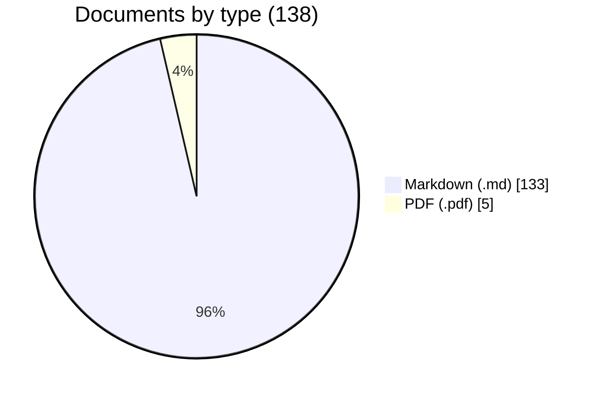

# Engineering evidence search (MVP)

This is a local evidence-search prototype. It gives cited answers from Markdown files and PDF files that have a text layer. It selects answers with heuristic rules, and it was measured only on a curated test repository. It has known defects that can give a wrong answer or an incomplete result. Read [Known limits and defects](#known-limits-and-defects) before you rely on a result.

The service answers questions about engineering values from a document repository, and shows the source of each answer.

An engineering lead asks a question in plain language. There are two kinds of answer:

- **One value.** "What is the roof load limit at Northgate?" gives the answer "The roof is designed for an imposed load of **0.6 kN/m²**." with its source.
- **A list of documents.** "Which documents have a roof load greater than 5 kN/m²?" gives each matching document, with the line that qualifies it.

Each answer shows:

- The exact sentence or table row from the document. The service does not write or change any text.
- The file and, for a PDF, the page number.
- The line range in the file or page.
- The SHA-256 hash of the file version.

Thus the user knows where each quoted value is, and does not need to open the file. This is proof of the source, not proof of the answer: the cited text can state a value that does not answer the question (see [How answers work](#how-answers-work)).

The MVP reads Markdown (`.md`) and simple PDF files that have a text layer. It does not do OCR. It does not read DXF, DWG, JT, CATIA or other CAD formats.

## Contents of the repository

| Folder or file | Contents |
| --- | --- |
| `engineering_search/` | The service: index, search, permissions, audit, web pages and the MCP server |
| `test-repository/` | Test documents only (138 files). It stands in for the company's document repository. See `test-repository/TEST-DATA.txt` |
| `evaluation/` | Test questions, saved scores, and [what they mean](evaluation/README.md) |
| `scripts/` | Scoring, test-PDF generation, packaging and benchmark scripts |
| `tests/` | Automated tests. `tests/test_no_leaks.py` checks that no user gets information from a file that they cannot read |
| `design/` | System design document and diagram |
| `docs/adr/` | Architecture decision records |

Other documents:

- [RUNNING.md](RUNNING.md): how to install and run the service.
- [docs/MCP.md](docs/MCP.md): how to install and test the MCP server with Claude Code or Claude Desktop, and what to ask.
- [ARCHITECTURE.md](ARCHITECTURE.md): how the code works, with the [code architecture diagram](design/code-architecture.png).
- [design/SYSTEM-DESIGN.md](design/SYSTEM-DESIGN.md): the proposed design: constraints, gaps, phases and metrics. It separates what is built from what is proposed.
- [design/EXTRACTION.md](design/EXTRACTION.md): which questions need which extracted metadata and properties, how to extract them, and where to store them.
- [design/DATA-PROFILE.md](design/DATA-PROFILE.md): why the profile of the real repository must come first. It defines the readers, the stores and the viewer.
- [docs/METRICS.md](docs/METRICS.md): the scores on the test data, why they are high, and their limits.
- [evaluation/README.md](evaluation/README.md): a short summary of what the results mean, and the gaps in the testing.
- [TODO.md](TODO.md): what is done, the gaps, and the next work.
- [GLOSSARY.md](GLOSSARY.md): the terms that these documents use.
- [design/SCALING.md](design/SCALING.md): how to grow past one machine.
- The [decision records](docs/adr/README.md): why each main decision was made.

## Quick start

You need Python 3.11 or later and `uv`. [RUNNING.md](RUNNING.md) gives all the options and how to run the tests.

```bash
uv sync --locked
```

```bash
uv run --frozen python -m engineering_search
```

Then open <http://127.0.0.1:8000/search>. Select a demo user. The sign-in screen tells you what each user can do and what to try.

The service indexes `test-repository/` when it starts. It keeps the index in `.runtime/`. When you start it again, it reads and hashes every file, and extracts passages only from the files that changed.

## How search works

The service uses an inverted index (SQLite FTS5). The index maps each word to the passages that contain it. A search looks up the words in the index. It does not read the document files, and the lookup does not scan the passages. This is the same method that dtSearch and Lucene use. After the lookup, the answer step reads the text of the stored passages: the 8 best passages for one value, and every passage of each matching document for a list.

The lookup returns at most 1,000 passages, from all files. The service applies permissions and the `within` scope after this limit. This is a known defect: see [Known limits and defects](#known-limits-and-defects).

The service changes the question into an index query in four steps:

1. It splits the question into words.
2. It removes common words, for example "what", "is" and "the".
3. It adds synonyms from a small engineering list. For example, "limit" also finds "maximum", "allowable" and "permitted".
4. It changes words that contain a digit into prefix searches. For example, "S355" also finds "S355J2+N".

The index also matches word forms, for example "load" and "loads", or "approved" and "approval".

A passage matches if it contains one or more of the query words. Passages that contain more of the query words come first. Then the BM25 score puts the best of the remaining passages first. Words in a heading count three times. Words in the file name also count, at half weight.

The result shows the words that the service searched for, for example `Searched for: roof · load · limit (or maximum, …) · northgate`. This lets the user see why a passage matched.

### This is a basic method

Keyword search on an inverted index is the simplest method that meets the use case on the test documents. It is a starting point, not the solution. It finds words, not meanings. For example:

- It finds a different word for the same thing only if the small synonym list has it.
- It does not know that two names refer to the same project.
- It does not know which element a value belongs to. "Roof load 0.6 kN/m²" and "floor load 5 kN/m²" are two lines of text to it. Thus it can return the floor load for a roof load question, and mark it `found` (see [How answers work](#how-answers-work)).

Better methods exist. Hybrid search adds embeddings (a semantic store) to the keyword index. Metadata filters find a project or a revision exactly. A facts store keeps each load limit, material and approval status as a record with its unit and source. But each of these makes the indexing phase, which is the extraction phase, much larger. The index can only answer questions about information that the extraction put into it.

Thus the questions must come first. Before the team selects extractors and indexes, it must know:

1. **What information the documents hold.** Which formats, which structure (title blocks, tables, schedules, revisions), and how consistent they are across projects and years.
2. **Which questions the users ask**, in their own words.
3. **Which answers they need.** One value, a list of documents, a status or a comparison, and which source is the authority.

This needs research on a sample of the real documents and with real users. From the results, the team derives the question types, the extractors, the stores and the indexes for that document set. There is no single method that suits all document sets and all questions. [design/EXTRACTION.md](design/EXTRACTION.md) gives a first map from question types to extraction methods and stores. That work is a larger goal than this MVP.

## How answers work

The service does not use a language model to answer. It selects text from the documents. The code is in [`answer.py`](engineering_search/answer.py).

**One value.** The service splits the 8 best passages into sentences and table rows. It keeps the parts that state a value: a number with a unit, a material grade (for example S355J2+N or C30/37) or a status (approved, pending, rejected, draft). The part that contains the most question words is the answer. Words in the heading and the file name also count. If a question word is missing from that sentence, the next sentence is added when it contains the word. Up to five other documents that also state a value, from the same 8 passages, are shown below the answer, so the user sees some conflicts. This is not every value in the repository.

**Answer status.** Each answer has a status:

- `found`: the sentence states a value, and the whole document contains every question word somewhere.
- `partial`: the closest sentence states a value, but its document lacks some question words. `missing_words` names them.
- `not_found`: no sentence in the 8 best passages states a value and contains at least half of the question words.

`found` is a word check, not a check of the answer. It does not check that the question words describe the selected value. For example, a document says "Roof load is not specified. Floor load limit is 5 kN/m²." The question "What is the roof load?" gets "Floor load limit is 5 kN/m²" with status `found`. Always read the quoted text.

**A list of documents.** Questions such as "Which documents…", "Do we have any documents…" or "documents with…" give a list. A document is in the list if it contains every question word (in its text, headings or file name). Each entry shows the line that best shows why. A list returns at most 200 documents. `count` and `truncated` show when there are more, but the other documents cannot be retrieved: `page` pages only the supporting passages, not the list.

**Numbers.** "greater than", "less than", "at least", "of" and similar words with a quantity filter the list by value. The service converts units, for example 5000 N/m² = 5 kN/m² = 5 kPa. Two limits:

- A line qualifies if it contains a qualifying quantity and at least one question word. The quantity can belong to a different element. For example, a document with roof load 0.6 kN/m² and floor load 10 kN/m² qualifies for "roof load greater than 5 kN/m²", and the list cites the floor load.
- Signs are not read. "-2 kN/m²" is read as 2 kN/m².

**Follow-up questions.** After a list, select "Ask the next question about these documents only". For example, ask "Do we have any documents in Northgate?", then "Of those documents, which mention compliance?". The API and MCP tool take the same list as `within`. If the list was truncated at 200 documents, the follow-up uses only those 200.

**No answer.** If no readable passage among the best matches states a value that matches enough question words, the service says "not found". It gives no value. But "found" does not prove that the value is the right one (see above), and "not found" can also mean that the file was not readable (for example, a PDF without a text layer).

These rules are a first version of the extraction that a later phase does when it indexes the files. [design/EXTRACTION.md](design/EXTRACTION.md) explains the next steps.

## The test documents

`test-repository/` has 138 files: 133 Markdown files and 5 PDF files. 120 of the files are generated from one template. Thus the "100+ documents" requirement is met in count, but most of the files have the same structure.



| Folder | Markdown | PDF | Contents |
| --- | ---: | ---: | --- |
| `generated-projects/` | 120 | 0 | Generated project sheets: roof load, steel grade, approval status |
| `project-cedar/` | 10 | 0 | One small project: loads, beams, materials, approvals, one restricted incident |
| `project-northgate/` | 0 | 1 | Warehouse structural calculations, 4 pages |
| `project-riverside/` | 0 | 1 | Footbridge load rating, 3 pages |
| `public-fhwa/` | 0 | 2 | Two real public FHWA bridge documents, 25 and 172 pages |
| `registers/` | 0 | 1 | Material approval register, 2 pages |
| `specifications/` | 3 | 0 | Roof load and bridge specifications, one of them a draft |
| **Total** | **133** | **5** | **138 files** |

After sign-in, the search page shows the same breakdown, as a chart and a folder table, for the files that the user can read.

## Users and permissions

All files in the repository are indexed. Each user sees results only from files that the user can read.

Three pretend users are available. Anyone can select any user. This is not real sign-in.

| User | Role | Can read |
| --- | --- | --- |
| JP | Engineering lead | All files (138 of 138) |
| Kamal | Structural engineer | All files, except `specifications/`, `project-northgate/` and four Project Cedar files (130 of 138) |
| Maya | Index team | All files, except five Project Cedar files (133 of 138). Maya can also index files and read the audit log |

Read access for each folder. ✓ means all files, ✕ means no files, and a number means some files.

| Folder | Files | JP | Kamal | Maya |
| --- | ---: | :---: | :---: | :---: |
| `generated-projects/` | 120 | ✓ | ✓ | ✓ |
| `project-cedar/` | 10 | ✓ | 6 of 10 (01 to 05, 09) | 5 of 10 (01, 02, 06 to 08) |
| `project-northgate/` | 1 | ✓ | ✕ | ✓ |
| `project-riverside/` | 1 | ✓ | ✓ | ✓ |
| `public-fhwa/` | 2 | ✓ | ✓ | ✓ |
| `registers/` | 1 | ✓ | ✓ | ✓ |
| `specifications/` | 3 | ✓ | ✕ | ✓ |

Thus Kamal gets no answer from the Northgate PDF or the specifications. Kamal can still get a Northgate value that another readable file states, for example the purlin steel in the material approval register. The sign-in screen shows the same table for each user.

The rules are in `ACCESS_RULES` in [`engineering_search/access.py`](engineering_search/access.py). A rule applies to the whole repository, to a folder, or to one file. The most specific rule applies. The assumptions are at the top of that file.

The service checks permissions on each search, after the index lookup and before it selects the answer, counts and pages the results. A response contains no text, names or counts of files that the user cannot read. `tests/test_no_leaks.py` checks this for each user. It asks every evaluation question, and questions made from the text of each forbidden file, in each mode. It checks the first five result pages of 50 passages each, not every page. It also tries to name forbidden files in a follow-up question and to read them directly.

**Known defect.** The index lookup keeps only the 1,000 best passages before the permission check. If forbidden passages rank higher, they can push a user's permitted passages out. The user then gets fewer results, or `not_found`, although the readable file is unchanged. Thus forbidden files can change what a user sees, and permitted evidence is lost. The tests do not check that adding forbidden files leaves a user's results unchanged.

The only intended exceptions to the permission rule are two aids for the demo and for the index team:

- The sign-in screen shows how many files of each folder each demo user can read. It shows no file names and no text.
- The audit log, which only the index team can open, records the file names and lines of each permission decision. It records no document text.

## Three ways to search

All three ways use one search service (`SearchService` in [`service.py`](engineering_search/service.py)). They use the same index, the same permissions and the same audit log.

1. **Web page.** Open `/search`, select a user, and type a question.
2. **HTTP API.** Send `POST /search` with `{"query": "What is the roof load limit at Northgate?"}`. Optional fields: `mode` (`auto`, `answer` or `list`), `within` (a list of file IDs), `limit` and `page`. The response has `answer` and the supporting passages in `evidence`.
3. **MCP server.** A chat agent, for example Claude Desktop or Claude Code, can call the tools `search_evidence` and `read_evidence`. See [docs/MCP.md](docs/MCP.md) to install and test it.

> **Security hole.** The MCP server does not match the person who uses the chat client to the file permissions. It takes the user from the `--user` flag in the client configuration, and nothing checks that flag. Anyone who can edit that configuration can search as JP and read every file. Do not connect the MCP server to real restricted documents until this is fixed. [docs/MCP.md](docs/MCP.md#the-security-hole-the-mcp-user-is-not-verified) explains the hole and the fix.

The MCP server satisfies the "chat-agent shell" constraint in the brief. The agent writes the reply in plain language. The service supplies the answer text and its source, so the agent does not need to find or calculate a value. Nothing checks that the agent's reply matches the tool result. The agent can still misquote a value, or present a `partial` answer as a fact.

## Audit

The service records each search in `.runtime/audit.sqlite3` before it returns the results. The record contains the user, the permission decision for each file, and the file, version and line range of each returned passage. It does not contain the question text or the passage text.

If the service cannot write the audit record, it returns no evidence.

## Measure search quality

Two sets of checks measure the service:

- **Acceptance tests** in [`tests/`](tests/) enforce the use case: the correct value, file and page; the answer text is in the file at the cited lines; each question takes less than 10 seconds; and no user gets information from a file that the user cannot read.
- **Scored questions** in [`evaluation/questions.json`](evaluation/questions.json). On the test data, every scored answer is correct, Success@1 is 0.94, there are no permission leaks, and the median time is 16 ms. The time is for the search service in one process. The time of a full chat-agent reply, with its language model, is not measured.

**Do not read these scores as the quality on real documents.** The same team wrote the documents, the questions and the code. The documents are synthetic and clean, and there are only 16 scored questions. A "correct answer" comes from an expected file and contains an expected text. The metric does not check that the value belongs to the asked element, that it is the current revision, or that "not found" is correct. Passing these checks does not contradict the defects in [Known limits and defects](#known-limits-and-defects). [evaluation/README.md](evaluation/README.md) explains what the results mean and lists the gaps in the testing. [docs/METRICS.md](docs/METRICS.md) gives the full detail.

## Know the data first

The real repository is not like `test-repository/`. It has years of files in many formats and versions: PDF with and without a text layer, CAD, BIM, Office files and more. The profile of that data defines the system:

- **Readers.** Which software must open each format and version. The file extension is not enough to decide this.
- **Extraction and parsing.** Where the load limits, materials and approval statuses are: text, tables, title blocks or attributes.
- **Downstream stores.** What goes into the structured stores (metadata and facts) and the unstructured stores (keyword index and embeddings), each with an exact location.
- **Viewing.** Users query a document first, but often they then want to see it: the table around a value, or the drawing with the element. The viewer must read the same formats, open the cited location and version, and apply the same permissions. Often the same software can extract and show a format, so select the readers and the viewer together.

[design/DATA-PROFILE.md](design/DATA-PROFILE.md) lists what to measure in the real repository and how the result controls the design.

## Known limits and defects

The most important limits:

- **Security.** Sign-in is pretend, and the MCP server does not verify its user. Do not use this service as a security boundary.
- **Search method.** Keyword search with rules. It does not know which element a value belongs to, and it does not decide which document is current when documents disagree.
- **Files.** Markdown and PDF with a text layer only. No OCR and no CAD.
- **Test data.** All scores come from 138 clean test files, and 120 of them come from one template.

Known defects. These are errors in the code, found in an independent review and reproduced. They are not fixed, and the tests do not detect them:

- **Wrong value marked `found`.** The status checks words against the whole document, not against the selected value. A floor load can be the `found` answer to a roof load question.
- **Retrieval limit before permissions.** The index lookup keeps 1,000 passages before permissions and `within` are applied. Permitted results can be lost, and forbidden files can change a user's result.
- **Signs ignored.** "-2 kN/m²" is compared as 2 kN/m².
- **Lists stop at 200 documents.** The rest cannot be retrieved, because `page` does not page the list.
- **One unreadable file stops the index refresh.** A file read error (for example, `PermissionError`) fails the whole refresh, although extraction errors are skipped.
- **Two processes can overwrite a newer index.** The web service and the MCP server do not coordinate their index refreshes on a shared state folder.
- **PDFs without text count as indexed.** They are not reported as not searchable.

[ARCHITECTURE.md](ARCHITECTURE.md#known-defects) gives the code location of each defect. [TODO.md](TODO.md) gives all the gaps and the next work. [ARCHITECTURE.md](ARCHITECTURE.md#mvp-shortcuts-in-the-code) lists the shortcuts in the code.
