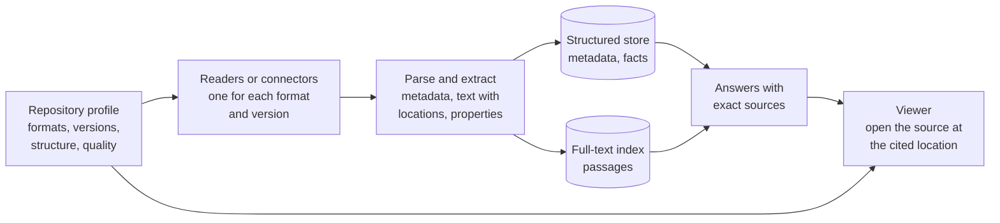

# Know the data first: the repository profile

The MVP works on a small, clean test repository that we made. The real system must work on the company's existing repository ([C2](../docs/constraints/constraints.md#c2)), with years of files in many formats ([B1](../docs/constraints/background.md#b1)). The brief says connectors already extract metadata, text and properties from the supported files ([C3](../docs/constraints/constraints.md#c3)); the MVP's readers only stand in for them ([ADR 0001](../docs/adr/0001-prove-the-use-case-with-stand-in-readers.md)). Before the team chooses which connectors to use first, and how to store what they give, it must know what that repository holds. This document tells you why, what to measure, and how the result controls the design.

## 1. Why the profile comes first

Each stage of the system depends on the stage before it:

A semantic store (embeddings) is out of scope ([O1](../docs/constraints/gaps.md#o1)), so it is not drawn.

- **A reader can only read the formats and versions that it supports.** A DWG file from 2004 and a DWG file from 2024 can need different software. A PDF can have a text layer, or it can be a scanned image that needs OCR. The file extension does not tell you this.
- **The extractors can only extract what the files contain.** If a load limit is in a CAD title block attribute, a text extractor does not find it. If it is in a scanned calculation sheet, only OCR finds it.
- **The stores can only answer questions about what the extractors put into them.** A structured store answers "all documents with S355" exactly only if each material was extracted as a property. A keyword index only finds the words.
- **Thus the profile defines the readers, the readers define what can be extracted, and the extracted data defines which questions can be answered.**

If the team skips the profile, it can build good software for formats that are rare, and have no reader for the formats that hold most of the answers.

## 2. What to measure

Run an inventory over the whole repository, or over a large random sample. Use the file content to identify each format, not the file extension.

| Area | What to measure | Why it matters |
| --- | --- | --- |
| Formats | Count and total size for each format: PDF, DWG, DXF, DGN, RVT, IFC, JT, CATIA, STEP, Word, Excel, email, images | Which readers are needed first |
| Format versions | The version of each file, for example the DWG version or the PDF version | One format can need more than one reader. Old versions can have no supported reader |
| PDF type | Text layer, scanned image, mixed, forms, encrypted, password-protected | Scanned pages need OCR. Encrypted files need keys or a policy |
| Structure | Title blocks, schedules, tables, attributes, layers, sheets, bookmarks, headings | Where the parameters are, and how to give an exact location |
| Parameters | Where load limits, materials and approval statuses appear: text, table, attribute, title block, separate register | Which extraction method each parameter family needs |
| Units and notation | kN/m², kPa, psf, kip; S355, ASTM A992; decimal commas | Unit conversion and the parameter dictionary |
| Status words | How approval and status are written: "Approved", "APPROVED FOR CONSTRUCTION", "Accepted" | One vocabulary to compare them ([G6](../docs/constraints/gaps.md#g6)) |
| Projects and metadata | Project codes and names, discipline, status, author, dates; where each one is kept (path, file properties, title block, document system) | Metadata filters such as "at Northgate" |
| Copies and drafts | Drafts, copies, duplicates and near-duplicates of the same document | The system does not decide which one governs ([K3](../docs/constraints/clarifications.md#k3)), so the user sees them all. Many copies make answers noisy |
| References | External references (xrefs), linked files, missing links | A drawing can depend on other files to be complete |
| Age and quality | File dates, damaged files, empty files, very large files | Coverage, failed files and indexing time |
| Languages | The languages of the text | Tokenizer, stemming, synonyms |
| Permissions | How access is set: folders, groups, document system roles, exceptions | How to apply the repository's access rules to every answer, exactly ([G1](../docs/constraints/gaps.md#g1)) |
| Change rate | Files added, changed and deleted each day | Indexing capacity, and how often to refresh ([G5](../docs/constraints/gaps.md#g5)) |

Record the results in a table that the team can repeat. Run the inventory again after a change in the repository.

The MVP has a small version of this inventory: the coverage report (`GET /index/coverage` and the MCP tool `get_index_coverage`, index team only). It counts the files by type and format version, by status, by top folder and by capability, and lists each file that was not fully read, with the reason ([G8](../docs/constraints/gaps.md#g8)). It detects the type from the content for PDF, XLSX, DOCX, JT and DXF; for the others the extension decides. It reads the version in a JT header and a DXF `$ACADVER`, and nothing more. It is a starting point for the profile, not the profile.

## 3. From the profile to the readers

For each format and version that holds a significant part of the answers, the team must choose a reader. A reader is the software that opens the file and gives its content to the system. The brief says that connectors and APIs already exist for supported files. The profile tells the team which formats they support, which formats they do not support, and how much of the repository is in each group.

For each reader, record:

- the formats and versions that it reads, and its tested limits;
- what it gives: metadata, text with locations, properties, geometry, images;
- how it gives a location: page and box for PDF, sheet or layout and entity handle for CAD, cell for a spreadsheet;
- its licence, its cost and where it can run (server, desktop only, cloud);
- its speed on the largest files.

The MVP keeps this behind one interface, so a real connector can replace a stand-in ([ADR 0001](../docs/adr/0001-prove-the-use-case-with-stand-in-readers.md)). Each reader has a manifest (file types, tested format versions, capabilities, dependencies), one registry chooses the reader, and the inventory records `reader_id@reader_version` for each file. The stand-ins read Markdown, text-layer PDF, CSV, XLSX and the notes and title block of an ASCII DXF drawing.

## 4. Structured and unstructured downstream systems

The same reader output must feed two kinds of downstream systems ([C4](../docs/constraints/constraints.md#c4)).

| Downstream system | What it needs from the reader | Questions it answers |
| --- | --- | --- |
| Structured store: metadata and facts | Exact properties with types: project, status; parameter, value, unit, element; each with its source location | "All documents with S355", "roof loads above 5 kN/m²", "approval status of Northgate" |
| Full-text index | Text in reading order, divided into passages, each with its location | Questions in plain language, topics with no fixed property |

Both must keep the same location for the same information. Then the system can show one source, and the user can check it. [EXTRACTION.md](EXTRACTION.md) gives the map from question types to extraction methods and stores.

There is no single design that suits all repositories. A repository of mostly scanned calculation sheets needs OCR and table extraction first. A repository of mostly CAD drawings needs title block and attribute extraction first. A repository of mostly reports needs good text and table extraction from PDF and Word. The profile tells the team which case it has.

## 5. Users will want to see the document

The brief asks for an answer without opening a CAD file or a PDF viewer ([U6](../docs/constraints/use-case.md#u6)). That is correct for the first step: find the value. But after a lead finds a value, the lead often wants to see it in its context. For example:

- the full table or the calculation around the value;
- the drawing, with the element that the value applies to;
- the revision block, the signature or the approval stamp.

Thus the real system will probably need a viewer, or a link into an existing viewer. This is beyond the MVP ([S2](../docs/constraints/scope.md#s2)), but it has consequences for the design:

1. **The viewer must read the same formats as the readers.** Often the same software (the same SDK or vendor library) can extract the content and show it. Choose readers and viewers together, from the same profile.
2. **The location must work in the viewer.** A source location such as "page 4, lines 6 to 8" is enough for the MVP. A viewer needs a location that it understands: a page and a box for PDF, a sheet or layout and an entity handle for CAD, a cell for a spreadsheet. The readers must record that location at index time.
3. **The viewer must show the same bytes.** The answer carries the file's content fingerprint (a SHA-256 of its bytes). The file on disc may have changed since; the service refuses to quote a changed file ([ADR 0003](../docs/adr/0003-quote-the-source-and-refuse-rather-than-guess.md)). A viewer should check the same fingerprint, and say so when the file has changed.
4. **The viewer must apply the same permissions.** A user who cannot read a file must not be able to open it in the viewer ([K13](../docs/constraints/clarifications.md#k13)).
5. **The viewer can run in the browser or on a server.** A browser viewer for PDF is simple. A viewer for DWG, JT or CATIA can need a server that changes the drawing into a web format. That is a cost and a licence question.

The MVP shows the exact text and its location, and it has no viewer. For a table row it gives the line (CSV, Markdown, DXF) or the sheet and sheet row (XLSX). That meets [U6](../docs/constraints/use-case.md#u6) for Markdown, text PDF, CSV, XLSX and a DXF title block. For the real system, plan the viewer with the readers.

## 6. Steps

1. Run the inventory (section 2) on the real repository, or on a large random sample.
2. Find where the three parameter families are: load limits, material specifications and approval statuses. Do this with engineers, on a sample of real documents.
3. Collect real questions and the answers that the users need ([G4](../docs/constraints/gaps.md#g4); see [docs/METRICS.md](../docs/METRICS.md)).
4. Rank the formats by the share of answers that they hold, not by the number of files.
5. Choose and test a connector, and a viewer, for each format at the top of the list.
6. Design the structured store and the full-text index for those questions. See [EXTRACTION.md](EXTRACTION.md).
7. Measure on the real questions. Then repeat for the next formats.
