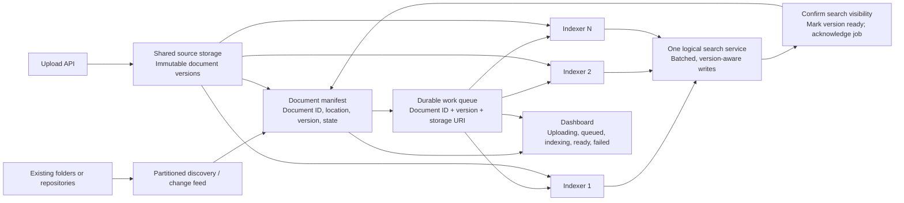

# From local uploads to hundreds of thousands of documents

Document count alone does not establish a need for distributed storage. Measure total bytes, passage count, extraction cost, arrival rate, query load and required recovery time. Folder layout can partition discovery; it should not dictate one independent search index per folder. Use one logical search service that can shard internally as capacity requires.

## The MVP today

The MVP runs on one machine: one process, SQLite files, a local upload queue with worker threads, and one lock for the index. [ARCHITECTURE.md](../ARCHITECTURE.md#mvp-shortcuts-in-the-code) lists these shortcuts. It has not been tested with hundreds of thousands of files or with many users at the same time.

## Changes required for multiple machines

1. **Shared sources and a persistent manifest.** Workers need a resolvable source URI. Object storage or an existing shared repository is generally simpler than copying all files to every machine. If files remain on different hosts, run discovery agents there and enqueue accessible versioned references. Separate upload progress from saved/validated content and index visibility. Use a transactional outbox (or equivalent reconciliation) to close the gap between a committed document version and a queued message.
2. **A shared broker with leases.** A worker claims a job, renews its lease while working, and acknowledges after the result is safely committed. Expired claims become available again. Treat delivery as at least once; duplicate processing remains possible, so writes must be idempotent. AWS's [visibility timeout documentation](https://docs.aws.amazon.com/AWSSimpleQueueService/latest/SQSDeveloperGuide/sqs-visibility-timeout.html) describes this lease/redelivery model. The local SQLite startup recovery is not a distributed lease mechanism.
3. **Idempotency and ordering.** Identify work by document ID, source version and extractor version. Reject an older version if a newer version has already been indexed. Represent deletion as a versioned tombstone so a late worker cannot resurrect removed content. The MVP avoids overwrite conflicts by assigning each upload a new identity; replacing an existing uploaded document is a separate future operation.
4. **One logical, persistent search index.** Scale extraction workers separately from search shards. Batch index writes, watch backpressure and keep commits atomic per document version. An accepted write is not always searchable immediately: Elasticsearch's [refresh documentation](https://www.elastic.co/docs/reference/elasticsearch/rest-apis/refresh-parameter) distinguishes those states and supports waiting for visibility. Only then advertise the version as ready. Adding workers does not help if storage, the broker or index commits are the bottleneck.
5. **Incremental discovery and paginated operations.** Partition a large initial crawl by stable directory ranges or hashed document IDs. Stream jobs instead of loading the corpus at once. Use change notifications plus periodic reconciliation, enqueue only changed versions, and paginate the inventory server-side. Folder boundaries are discovery partitions, not exclusive ownership of documents by long-lived workers.
6. **Operational controls.** Use bounded retries with backoff for transient failures, a dead-letter state for persistent failures, upload quotas and admission control. Show total state counts, oldest job age, queue-wait and upload-to-searchable p50/p95/p99, worker utilisation, files/bytes/passages per second, failures, retries and query latency under ingestion load. A stopped or failed worker must not remain indefinitely active on the dashboard.
7. **Security before shared deployment.** Replace selectable demo identities with authoritative identity verification and the mock permissions database with the existing permissions service. Keep the enforced file checks, backend-role boundary and protected decision audit. Preserve permissions and source versions through every queue stage. Never expose forbidden candidate IDs through consumer search, the dashboard or audit-reading APIs.

## Capacity experiment

Benchmark representative file sizes and tables with 1, 2, 4 and 8 workers. Measure both initial backfill and steady arrivals while representative searches run. A rough starting point for extraction capacity is `workers × measured documents/second/worker`, reduced for shared-storage and index contention. To avoid an ever-growing backlog, sustained completion rate must exceed arrival rate. Scale based on queue age and target upload-to-searchable latency, not merely folder count. The ten-second search target remains separate from indexing freshness.
