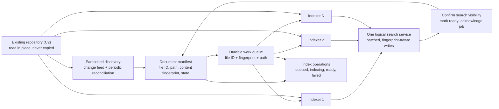

# From one local process to hundreds of thousands of documents

The MVP is one local process ([ADR 0010](../docs/adr/0010-a-local-single-process.md)). Serving any number of users within 10 seconds, over a repository far larger than the test set, with the index kept up to date, is gap [G5](../docs/constraints/gaps.md#g5). This page records what the MVP measured and what more machines would need. It is a sketch for G5, beyond the MVP's scope ([S2](../docs/constraints/scope.md#s2)), not a plan to build.

Document count alone does not establish a need for distributed storage. Measure total bytes, passage count, extraction cost, change rate, query load and required recovery time. Folder layout can partition discovery; it should not dictate one independent search index per folder. Use one logical search service that can shard internally as capacity requires.

The indexers read the repository where it is, through its connector or a mount ([C2](../docs/constraints/constraints.md#c2), [C3](../docs/constraints/constraints.md#c3)). There is no upload path ([K12](../docs/constraints/clarifications.md#k12)).

## The MVP today

The MVP runs on one machine: one web process (plus one MCP process for each chat client), two SQLite files (the index and the audit log), one lock and one SQLite connection in each process, and a file lock that lets one process at a time publish index changes. [ARCHITECTURE.md](../ARCHITECTURE.md#mvp-shortcuts-in-the-code) lists these shortcuts.

The index is refreshed on start and on request ([K16](../docs/constraints/clarifications.md#k16)). The indexer hashes every file and re-reads only new and changed files. Nothing watches the repository; a file changed between refreshes is refused rather than quoted stale ([ADR 0007](../docs/adr/0007-the-source-is-the-file-on-disc.md)).

### Measured concurrency

Measured on 29 October 2026 with [`scripts/load_test.py`](../scripts/load_test.py), on a laptop, one process, the test repository (148 files then; the DXF drawing came later), mixed text questions and the S355 SQL query, as JP, Kamal and Maya.

- **One process answers about 10 requests a second, whatever the load.** `SearchService.lock` is held from the file match to the audit write, and the index has one SQLite connection. Without admission control, with 1,000 requests at once, the last waited 102 s.
- **Admission control holds the budget** ([ADR 0008](../docs/adr/0008-a-time-budget-and-admission-control.md)). Each request is answered within 8 s or refused at once with a retry time:

| Requests at once | Answered | Slowest answer | Refused as busy | Slowest refusal |
| --- | --- | --- | --- | --- |
| 1 | 1 | 0.12 s | 0 | — |
| 10 | 10 | 0.73 s | 0 | — |
| 100 | about 50 | 5.7 s | about 50 | 0.02 s |
| 1,000 | about 47 | 5.5 s | about 953 | 0.24 s |

- **The guarantee is bounded latency, not capacity.** With 1,000 requests at once, most users are told to retry. Admission is per process.
- **The constrained SQL path copies data for each request.** It builds an in-memory projection of every permitted fact: about 3 µs a fact, so about 3 s at a million facts. Its step budget does not grow with the data, and stops the S355 query above about 200,000 facts.

It has not been tested with hundreds of thousands of files. [docs/README.md](../docs/README.md#making-it-available-to-an-organisation) explains what high availability for the organisation needs: a stateless query tier, a replicated store with failover, permissions in the store, a separate indexing line, quotas, service-level objectives and load tests in CI.

### What must change first, in order of value

1. **Concurrent reads in one process.** One read connection per thread, each request in one read transaction (a WAL snapshot), and no global lock for searches. The index lock stays for writers.
2. **Several worker processes** (or machines) reading the same index, behind a load balancer, with sessions out of process memory. Rough sizing at the test-data cost of 0.1 s a request: 1,000 users asking one question a minute is about 17 requests a second, so 3 to 4 workers at 60% load. The real repository must be measured.
3. **SQL without a copy per request.** Cache projections by permission set and index state, or enforce permissions inside a server database (row-level security, or views over a permitted-file table). Make `components` an indexed table, not a grouping view, and scale the step budget with the data.
4. **A server search engine** (or a server database with full-text search) when one SQLite file is no longer enough.
5. **Load tests in CI** at the expected size and concurrency, with the 10-second target as a gate ([K6](../docs/constraints/clarifications.md#k6)).

## Changes required for multiple machines

1. **Read the repository in place, and keep a persistent manifest.** Indexers need a path they can resolve: the existing repository through its connector, or a shared mount. Do not copy every file to every machine. If files stay on different hosts, run discovery agents there and queue references with their content fingerprint. Use a transactional outbox (or equivalent reconciliation) so a file seen by discovery is always queued.
2. **A shared broker with leases.** A worker claims a job, renews its lease while working, and acknowledges after the result is safely committed. Expired claims become available again. Treat delivery as at least once; duplicate processing remains possible, so writes must be idempotent. AWS's [visibility timeout documentation](https://docs.aws.amazon.com/AWSSimpleQueueService/latest/SQSDeveloperGuide/sqs-visibility-timeout.html) describes this lease and redelivery model.
3. **Idempotency and ordering.** Identify work by file ID, content fingerprint and reader version. Ignore a job whose fingerprint is no longer the file's current one. Represent deletion as a tombstone so a late worker cannot bring removed content back.
4. **One logical, persistent search index.** Scale extraction workers separately from search shards. Batch index writes, watch backpressure and keep commits atomic per file. An accepted write is not always searchable at once: Elasticsearch's [refresh documentation](https://www.elastic.co/docs/reference/elasticsearch/rest-apis/refresh-parameter) distinguishes those states and supports waiting for visibility. Only then mark the file ready. Adding workers does not help if storage, the broker or index commits are the bottleneck.
5. **Incremental discovery and paged operations.** Partition a large initial crawl by stable directory ranges or hashed file IDs. Stream jobs instead of loading the whole repository at once. Use change notifications plus periodic reconciliation, queue only changed files, and page the inventory on the server. Folder boundaries are discovery partitions, not exclusive ownership of files by long-lived workers.
6. **Operational controls.** Use bounded retries with backoff for transient failures, a dead-letter state for persistent failures, quotas and admission control. Show state counts, oldest job age, queue wait and change-to-searchable p50/p95/p99, worker use, files, bytes and passages per second, failures, retries and query latency while indexing runs. A stopped or failed worker must not stay "active" on the dashboard.
7. **Security before shared deployment.** Replace the selectable demo users with verified identity, and the path rules in `access.py` with the repository's own access controls ([G1](../docs/constraints/gaps.md#g1)). Keep the permission checks before ranking and limits ([ADR 0004](../docs/adr/0004-permissions-before-ranking-limits-and-counts.md)), and the audit before any evidence is released, in a durable store ([G2](../docs/constraints/gaps.md#g2)). Never expose a forbidden file ID through search, the dashboard or the audit pages.

## Capacity experiment

Benchmark representative file sizes and tables with 1, 2, 4 and 8 workers. Measure both the initial crawl and steady changes while representative searches run. A rough starting point for extraction capacity is `workers × measured files/second/worker`, reduced for shared-storage and index contention. To avoid a growing backlog, the sustained completion rate must exceed the change rate. Scale on queue age and the target change-to-searchable time, not on folder count. The 10-second search target ([U4](../docs/constraints/use-case.md#u4)) stays separate from how fresh the index is.
