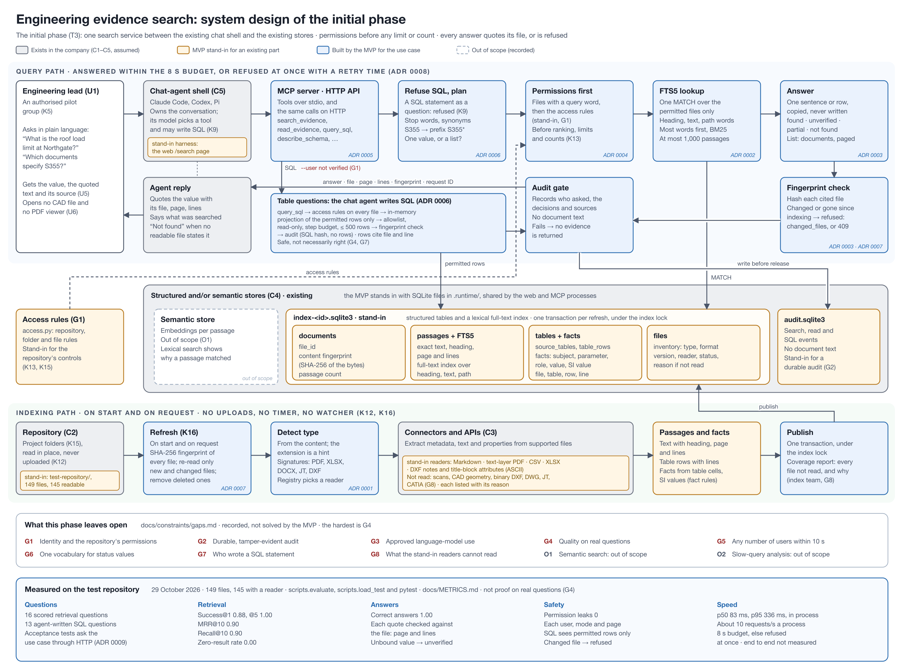

# The initial phase: a potential solution

This is the initial phase that the task asks for ([T3](../docs/constraints/task.md#t3)): a potential solution, given the [background](../docs/constraints/background.md), the [use case](../docs/constraints/use-case.md) and the [constraints](../docs/constraints/constraints.md) of [the brief](../docs/Starting_document.md) ([K11](../docs/constraints/clarifications.md#k11)). The [system design diagram](system-design.svg) is drawn from it ([T4](../docs/constraints/task.md#t4)). The MVP is the working prototype of it ([T5](../docs/constraints/task.md#t5)).

The IDs (B, C, U, T, S, K, G, O) are the items of [the brief analysis](../docs/constraints/README.md). The [decision records](../docs/adr/README.md) (ADR 0001–0011) record the choices. [ARCHITECTURE.md](../ARCHITECTURE.md) describes the code in full; where it and this page differ, it is correct.



Source: [system-design.svg](system-design.svg), made by [make_diagram.py](make_diagram.py). Grey boxes already exist in the company ([C1–C5](../docs/constraints/constraints.md), assumed). Amber boxes are the MVP's labelled stand-ins for them. Blue boxes are what the MVP builds for the use case. Dashed boxes are out of scope. [code-architecture.png](code-architecture.png) shows the modules of the code, their layers and their imports.

## The problem

Years of design information sit in design files and project documents ([B1](../docs/constraints/background.md#b1)). Users do not know which file holds what they need ([B2](../docs/constraints/background.md#b2)), and will not learn file formats, schemas, query languages or jargon ([B3](../docs/constraints/background.md#b3), [B4](../docs/constraints/background.md#b4)).

A selected engineering manager or lead ([U1](../docs/constraints/use-case.md#u1)) must find a critical parameter, such as a load limit, a material specification or an approval status ([U2](../docs/constraints/use-case.md#u2)), across 100+ project documents ([U3](../docs/constraints/use-case.md#u3)), in under 10 seconds ([U4](../docs/constraints/use-case.md#u4)), with 100% confidence in the source ([U5](../docs/constraints/use-case.md#u5)), without opening a CAD file or a PDF viewer ([U6](../docs/constraints/use-case.md#u6)). The six parts are one use case ([K1](../docs/constraints/clarifications.md#k1)).

## What exists, what stands in, what is out of scope

The brief says five things already exist. The solution does not build them. It sits between them, and the MVP stands in for each one only as far as the flow needs ([ADR 0001](../docs/adr/0001-prove-the-use-case-with-stand-in-readers.md)). Stand-ins are not grown into products.

| Part | Standing | In the MVP |
| --- | --- | --- |
| Architecture direction ([C1](../docs/constraints/constraints.md#c1)) | Existing, assumed | No stand-in. One service behind tools and an HTTP API, so the direction can place it ([ADR 0005](../docs/adr/0005-one-search-service-behind-tools.md)) |
| Repository ([C2](../docs/constraints/constraints.md#c2)) | Existing, assumed | Stand-in: [`test-repository/`](../test-repository/TEST-DATA.txt), 149 files, read in place. No uploads ([K12](../docs/constraints/clarifications.md#k12)) |
| Connectors ([C3](../docs/constraints/constraints.md#c3)) | Existing, assumed | Stand-in: sample readers for Markdown, text-layer PDF, CSV, XLSX and DXF (notes and title block), and fixed fact rules ([K7](../docs/constraints/clarifications.md#k7)) |
| Structured and/or semantic stores ([C4](../docs/constraints/constraints.md#c4)) | Existing, assumed | Stand-in: one SQLite file with tables, typed facts and an FTS5 full-text index ([ADR 0002](../docs/adr/0002-structured-tables-and-full-text-search.md)) |
| Chat-agent shell ([C5](../docs/constraints/constraints.md#c5)) | Existing, assumed | Claude Code, Codex or Pi call the MVP's MCP server. The web search page is a test harness, not a chat shell |
| Repository access controls ([K13](../docs/constraints/clarifications.md#k13), [K15](../docs/constraints/clarifications.md#k15)) | Needed, not in the brief | Stand-in: folder and file rules in `access.py` ([G1](../docs/constraints/gaps.md#g1)) |
| Durable audit | Needed, not in the brief | Stand-in: a local SQLite audit log ([G2](../docs/constraints/gaps.md#g2)) |
| Search service, answers, permissions, time budget | Built by the MVP | The part this phase is about (below) |
| Semantic search (embeddings) | Out of scope | Recorded as [O1](../docs/constraints/gaps.md#o1). Not a later phase of this plan |
| Analysis of slow queries | Out of scope | Recorded as [O2](../docs/constraints/gaps.md#o2) |

## The solution

One search service sits between the chat shell and the stores ([ADR 0005](../docs/adr/0005-one-search-service-behind-tools.md)). It reads the repository where it is, keeps an index of what the readers extract, and answers a question with a sentence or row copied from a file, with the file, the location and the quote. Indexing and searching are separate lines that meet only at the index. The MVP runs it as one local process ([ADR 0010](../docs/adr/0010-a-local-single-process.md)).

### A text question

The user asks in plain language. The chat shell calls the MCP tool `search_evidence`, or the web page calls `POST /search`. Both call `SearchService.search`.

1. **Refuse SQL.** A question that is a SQL statement is refused with a request for plain language ([K9](../docs/constraints/clarifications.md#k9), [ADR 0006](../docs/adr/0006-the-user-never-writes-sql.md)).
2. **Understand.** Drop stop words, expand a small synonym list, make codes such as S355 into prefix searches. Decide if the question asks for one value or a list, and find a number comparison ("greater than 5 kN/m²").
3. **Permissions first.** Find the files that contain a query word, then keep only those the user may read. This happens before any ranking, limit or count ([K13](../docs/constraints/clarifications.md#k13), [ADR 0004](../docs/adr/0004-permissions-before-ranking-limits-and-counts.md)).
4. **Look up.** One FTS5 query over the permitted files only. Passages with more question words rank first, then BM25, with statistics from the permitted matches only. At most 1,000 passages.
5. **Answer.** For one value: one sentence or table row that states a value, copied exactly. Its status is `found` only if every question word is in the sentence, its heading, the file path or the document title; otherwise `unverified` or `partial`; or `not found` ([ADR 0003](../docs/adr/0003-quote-the-source-and-refuse-rather-than-guess.md), [K14](../docs/constraints/clarifications.md#k14)). For a list: every readable document with a qualifying line, with the number comparison done in code, in pages of 200.
6. **Check the file on disc.** Hash each cited file. A file changed or gone since indexing is refused: it is listed in `changed_files` and the answer is picked again without it ([K3](../docs/constraints/clarifications.md#k3), [ADR 0007](../docs/adr/0007-the-source-is-the-file-on-disc.md)).
7. **Audit, then return.** Write the audit event. If that fails, no evidence is returned. Each source has the file, page, lines, the quoted text and the file's content fingerprint (a SHA-256 of its bytes).

The chat agent writes the reply. Nothing checks that its reply matches the tool result.

### A table question

For filters, joins and counts over tables, the chat agent (not the user, not the service) writes one SQL `SELECT` ([ADR 0006](../docs/adr/0006-the-user-never-writes-sql.md)).

1. `describe_schema` gives the tables, columns and units.
2. `query_sql` checks permissions on every indexed file, and builds an in-memory projection of the permitted files' tables, rows and facts only.
3. The statement runs under limits: one `SELECT`, an allowlist of tables and functions, a read-only connection, a step budget, at most 500 rows.
4. A row from a file changed since indexing is refused with 409. The audit records a hash of the statement, never the rows.
5. Each row carries its file, table, row, line and page. `get_document_evidence` returns the exact row and the passage that holds it.

The service limits what the SQL can read. It cannot tell who wrote the statement ([G7](../docs/constraints/gaps.md#g7)), and does not check that the SQL asks the right question ([G4](../docs/constraints/gaps.md#g4)).

### Keeping the index in step with the repository

A source is the file on disc as it is now; there are no revisions to manage ([K3](../docs/constraints/clarifications.md#k3)). The index is refreshed when the service starts and when the index team asks ([K16](../docs/constraints/clarifications.md#k16), [ADR 0007](../docs/adr/0007-the-source-is-the-file-on-disc.md)).

1. List every file. Detect its type and format version from the content; the extension is a hint.
2. Take a SHA-256 of each file. Re-read only new and changed files (and files whose reader changed). Remove files deleted from disc.
3. A registry picks a reader for each file ([ADR 0001](../docs/adr/0001-prove-the-use-case-with-stand-in-readers.md)). The reader returns passages (text with heading, page and lines) and tables. Fixed rules make typed facts from table cells, with SI values.
4. Publish the changes in one transaction, under a file lock, so processes that share the index take turns.
5. Every file that no reader takes, or reads only in part, is listed in the coverage report with the reason ([G8](../docs/constraints/gaps.md#g8)).

There is no timer and no watcher. Between refreshes, an edited file is refused rather than quoted stale. Automatic refresh is part of [G5](../docs/constraints/gaps.md#g5).

### The tools the shell calls

```text
search_evidence(question, mode?: "auto" | "answer" | "list", within?: [file_id], limit?: 1..50, page?)
  → answer (one value with its status and source, or a page of up to 200 documents),
    searched_for, changed_files, supporting passages (file, page, lines, fingerprint, exact text)

read_evidence(file_id, page?)
  → all passages of one file, or of one PDF page, if the user may read it

describe_schema() · list_tables() · describe_table(table)
  → the tables of the projection, their columns, units and citation notes

query_sql(sql, limit?: 1..500)
  → columns, rows, row_count, truncated; rows only from files the user may read

get_document_evidence(file_id, table_no, row_no)
  → the row as read, its facts, line, page, fingerprint and the passage that holds it

get_index_coverage(gaps_limit?)       # only for an index-team --user
  → coverage by type, format version, status, folder and capability, with each gap
```

The server runs over local stdio and needs no API key: the shell has its own model. It takes the user from its `--user` flag, which nothing verifies ([G1](../docs/constraints/gaps.md#g1)). [docs/MCP.md](../docs/MCP.md) says how to connect a shell.

## How the solution meets the use case

| Item | How | Still missing |
| --- | --- | --- |
| [U1](../docs/constraints/use-case.md#u1) a selected lead | An authorised pilot group ([K5](../docs/constraints/clarifications.md#k5)). Permissions before ranking, limits and counts, on both paths | Verified identity and the repository's own controls ([G1](../docs/constraints/gaps.md#g1)) |
| [U2](../docs/constraints/use-case.md#u2) a critical parameter | One quoted value with a status; a list for "which documents"; rows from agent-written SQL. Asked of Markdown, PDF, CSV, XLSX and a DXF title block | One vocabulary for status values ([G6](../docs/constraints/gaps.md#g6)) |
| [U3](../docs/constraints/use-case.md#u3) 100+ documents | One question searches every readable document across projects ([K10](../docs/constraints/clarifications.md#k10)): 145 files with a reader | |
| [U4](../docs/constraints/use-case.md#u4) under 10 seconds | An 8 s budget; a request that cannot meet it is refused at once with a retry time ([ADR 0008](../docs/adr/0008-a-time-budget-and-admission-control.md)) | Any number of users ([G5](../docs/constraints/gaps.md#g5)) |
| [U5](../docs/constraints/use-case.md#u5) 100% confidence in the source | Quotes copied, never written; file, location and fingerprint; refuse rather than guess; changed files refused | Proof on real questions ([G4](../docs/constraints/gaps.md#g4)) |
| [U6](../docs/constraints/use-case.md#u6) no CAD file, no PDF viewer | The answer carries the quote, heading, page and lines ([K4](../docs/constraints/clarifications.md#k4)). A PDF calculation and a DXF title block are answered without opening either | What the stand-in readers cannot read ([G8](../docs/constraints/gaps.md#g8)) |

[`tests/test_use_case.py`](../tests/test_use_case.py) asks the use-case questions through the HTTP API and checks every answer against the files ([ADR 0009](../docs/adr/0009-acceptance-tests-and-evaluation-sets.md)).

**Measured on the test repository (29 October 2026, 149 files, one laptop, one process).** Retrieval on 16 scored questions: Success@1 0.88, Success@5 1.00, MRR@10 0.90, Recall@10 0.90, correct answers 1.00, permission leaks 0. Search service time p50 about 83 ms and p95 about 336 ms. End-to-end time through a chat shell is not measured. [docs/METRICS.md](../docs/METRICS.md) explains why these scores do not predict real performance.

## What this phase leaves open

The [gaps page](../docs/constraints/gaps.md) holds each one ([T2](../docs/constraints/task.md#t2)): identity and permissions ([G1](../docs/constraints/gaps.md#g1)), durable audit ([G2](../docs/constraints/gaps.md#g2)), approved model use ([G3](../docs/constraints/gaps.md#g3)), quality on real questions ([G4](../docs/constraints/gaps.md#g4)), scale ([G5](../docs/constraints/gaps.md#g5), see [SCALING.md](SCALING.md)), an ontology of status values ([G6](../docs/constraints/gaps.md#g6)), who wrote a SQL statement ([G7](../docs/constraints/gaps.md#g7)) and what the stand-in readers cannot read ([G8](../docs/constraints/gaps.md#g8)). The hardest is G4.

What "100% confidence in the source" means here: every value shown is copied from a cited file, at an exact location, and the file on disc still holds those bytes. It does not prove that the engineering value is right, or that the quoted value is the parameter asked for: binding is a word check, not a check of meaning. The system never decides whether a file is a "current" or "approved" revision ([K3](../docs/constraints/clarifications.md#k3)); it states what the file says, and shows other documents that state a value.

## Beyond the initial phase

None of these is built or committed. Each is tied to the gap it would close. [EXTRACTION.md](EXTRACTION.md) works through extraction and stores in more detail.

| Area | Why it matters | Approach when needed | Cost and risk |
| --- | --- | --- | --- |
| Real connectors ([G8](../docs/constraints/gaps.md#g8)) | Scans, CAD geometry, DWG, JT and CATIA are not read | The existing connectors behind the same reader interface. Profile the repository first ([DATA-PROFILE.md](DATA-PROFILE.md)) | Extraction quality, licences |
| Citation check ([G4](../docs/constraints/gaps.md#g4)) | Nothing checks the agent's reply | A `verify_citations` tool: every number in the reply must be in a cited quote | Low; needs the shell to call it |
| Facts from free text ([G4](../docs/constraints/gaps.md#g4)) | A value in a sentence is not a fact, so SQL misses it | Pattern rules, then span-checked extraction ([EXTRACTION.md](EXTRACTION.md)) | Its own error rate |
| PDF tables ([G8](../docs/constraints/gaps.md#g8)) | PDF tables come out as lines of text | Table-aware extraction that keeps rows with their headers | Errors in complex layouts |
| Section paths and locators | Each passage has only its nearest heading, and a page and line range | Full heading paths; page and box, for a viewer ([DATA-PROFILE.md](DATA-PROFILE.md#5-users-will-want-to-see-the-document)) | Depends on what the connectors return |
| An ontology ([G6](../docs/constraints/gaps.md#g6)) | "Approved" and "APPROVED FOR CONSTRUCTION" are compared as written | An agreed vocabulary of parameters and status values, applied by the connectors | Hard over years of documents |
| Typo tolerance | "rooof laod" returns nothing | A trigram index, or "did you mean" from the index vocabulary | Low |
| Scale ([G5](../docs/constraints/gaps.md#g5)) | Many users, a far larger repository | A shared index service, a stateless query tier, automatic refresh ([SCALING.md](SCALING.md)) | Operations |

Semantic search is out of scope ([O1](../docs/constraints/gaps.md#o1)). Lexical search shows exactly why a passage matched, which the source check needs ([ADR 0002](../docs/adr/0002-structured-tables-and-full-text-search.md)). If real questions show paraphrases that the synonym list misses ([G4](../docs/constraints/gaps.md#g4)), adding it needs a new decision record.

## Measuring quality on real questions (G4)

[`scripts/evaluate.py`](../scripts/evaluate.py) scores 16 developer-written questions with Success@k, MRR@10, Recall@10, a zero-result rate, a lenient correct-answer check and a permission-leak count; a second set scores 13 questions for agent-written SQL ([evaluation/](../evaluation/README.md)). A claim about real quality needs more. This is the proposal for [G4](../docs/constraints/gaps.md#g4); none of it is built.

### Gold set

- **Size.** 60–100 questions from the pilot group, written the way they ask them, across load limits, material specifications and approval statuses, and across file types.
- **Graded labels per passage.** 2: the passage states the value. 1: the right section or document, but not the value. 0: not relevant.
- **Answer key.** For each question, the expected value, unit, file and location, checked by engineers. For a list question, the complete set of documents.
- **Special cases.** Questions not answered by any document (to test refusal); documents with several parameters (to test binding); documents that disagree; users with restricted access, and restricted documents that rank above permitted ones (to test that permitted results do not change).
- **Format.** TREC qrels, so standard tools can score it.

### Metrics

| Metric | Definition | Why it matters here |
| --- | --- | --- |
| **Success@k** | Share of questions with a grade-2 passage in the top k | Can the lead find the parameter? |
| **Recall@k** | Share of all grade-2 passages in the top k | Disagreeing values (5 vs 7 kN/m²) must all show |
| **MRR@10** | Mean of 1 / rank of the first grade-2 passage | How far down the answer sits |
| **nDCG@10** | Graded gain, discounted by position, against the ideal ranking | A standard comparable score |
| **Set precision and recall** | For list questions: correct returned ÷ returned, and ÷ all correct | A missed document is a missed value |
| **Value exact match** | The value and unit stated equal the answer key | The answer, not just the passage |
| **Citation precision** | Share of cited quotes that contain the stated value, checked in code | Must be 100% |
| **Refusal accuracy** | On questions no document answers, the share that say "not found" | Refuse rather than guess |
| **SQL accuracy** | Agent-written SQL returns the expected rows | The table path ([G7](../docs/constraints/gaps.md#g7)) |
| **Permission leaks** | Any file ID, passage, count or name from a file the user may not read | Must be 0 ([K13](../docs/constraints/clarifications.md#k13)) |
| **Latency** | p50, p95, p99 end to end and per stage, under concurrent load and while indexing | [K6](../docs/constraints/clarifications.md#k6): 95% within 10 s |

### Method

- Score runs with **ranx**, which reads TREC qrels and is validated against `trec_eval`.
- Report a bootstrap 95% confidence interval: with under 100 questions, intervals are wide.
- Compare variants with a paired significance test.
- Break every metric down by parameter type and file type.
- Run the harness on every release, so a change that lowers Success@10 or causes a leak fails ([ADR 0009](../docs/adr/0009-acceptance-tests-and-evaluation-sets.md)).

## Sources

- ranx: ranking evaluation and comparison, validated against TREC Eval: <https://pypi.org/project/ranx/>
- Gao et al., *Enabling Large Language Models to Generate Text with Citations* (ALCE), EMNLP 2023: <https://arxiv.org/abs/2305.14627>
- Thakur et al., *BEIR: A Heterogeneous Benchmark for Zero-shot Evaluation of Information Retrieval Models*, 2021 (nDCG@10 as the standard score): <https://arxiv.org/abs/2104.08663>
- Järvelin and Kekäläinen, *Cumulated gain-based evaluation of IR techniques*, ACM TOIS 2002 (nDCG): <https://doi.org/10.1145/582415.582418>
