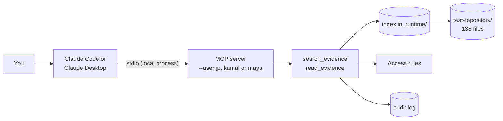

# Install and test the MCP server

This guide is for testers. It tells you how to connect a chat agent (Claude Code or Claude Desktop) to the engineering search, and what to ask. Each step takes less than five minutes.

The MCP server lets a chat agent answer questions from the documents. It uses the same search function, index, permissions and audit log as the web page. The chat client starts the server as a local process on your computer. The documents, the index and the audit log stay on your computer.



> **Security hole.** The MCP server does not check who uses it. It searches as the user that the `--user` flag names. Anyone who can edit the client configuration can search as JP and read every file. Use it only with the test documents. [The security hole](#the-security-hole-the-mcp-user-is-not-verified) below gives the details and the fix.

## How the MCP client and server work

MCP (Model Context Protocol) is a standard way for a chat agent to use tools. There are three parts:

| Part | In this test | What it does |
| --- | --- | --- |
| Host | Claude Code or Claude Desktop | The chat application. It holds the conversation and sends it to the language model (LLM) |
| Client | A connection inside the host, one for each server | It starts the server, and sends tool calls to it |
| Server | `engineering_search.mcp_server` | It gives the tools `search_evidence` and `read_evidence`, and runs them |

### When the host starts

1. The host reads its configuration. For each server, it runs the command, for example `uv run ... python -m engineering_search.mcp_server --user jp`. The server is a child process of the host, on your computer.
2. The client and the server send messages to each other through the standard input and output of that process (stdio). The messages are JSON-RPC. There is no network port.
3. The server opens the index and indexes the new and changed files. Then it tells the client its name, its instructions and its tools. Each tool has a name, a description and a schema for its inputs.
4. The host gives the tool descriptions and the server instructions to the LLM. Thus the LLM knows that the tools exist and when to use them.

The server stops when the host stops or when you remove the server. Each server process searches as one user, the user that `--user` names, for all of its life.

### When you ask a question

1. You type a question in the chat.
2. The LLM decides to use a tool. It writes the tool call, for example `search_evidence(question="What is the roof load limit at Northgate?")`. The LLM, not you, writes the arguments. It can change your words.
3. The client sends the call to the server.
4. The server runs the same `search_evidence` function as the web page: plan, index lookup, permissions, answer, audit. It returns a JSON result: the answer, its file, page, lines and version, what was searched for, and the supporting passages.
5. The host gives the result to the LLM. The LLM writes the reply in its own words. It can call a tool again, for example `read_evidence` to read a page, or `search_evidence` with `within` for a follow-up question.

The server does not see the conversation. It sees only the tool arguments. The LLM sees only what the server returns, and that is only text from files that the user can read.

### The MCP server and the search bar on the web page

Both use the same search function, the same index, the same access rules and the same audit log. Thus the same question as the same user gives the same answer. The differences are in how the question arrives and how the answer is shown.

| | Search bar (web page) | MCP server (chat agent) |
| --- | --- | --- |
| Who writes the search | You type the question | The LLM writes the tool call from your message |
| Process | The web service runs all the time. It serves many browser sessions | The chat client starts one process for each server. It stops with the client |
| Connection | HTTP on `127.0.0.1:8000` | stdio between the client and its child process. No port |
| Who the user is | Selected on the sign-in screen. A session cookie holds it (pretend sign-in) | Fixed by `--user` in the client configuration. Not verified |
| Result | The page shows the answer panel and the passages, exactly as returned | The LLM reads the JSON result and writes a reply in its own words |
| Follow-up questions | You select "Ask the next question about these documents only" | The LLM must send the file IDs of the previous list in `within` |
| Where the text goes | Only to your browser | To the LLM provider too, because the LLM must read the result |
| Other functions | Index operations, uploads and the audit log (Maya) | Search and read only |

Two results of these differences:

- **The reply is not the evidence.** The service controls the tool result. It does not control the reply that the LLM writes. The LLM can shorten, reword or, in a bad case, change a value. The instructions tell it to quote values and cite the source. A tester must compare the reply with the tool result.
- **Permitted text leaves the computer.** The search bar shows text only in your browser. A chat agent sends the tool result to the LLM provider. A company must approve this for its documents.

## The security hole: the MCP user is not verified

The MCP server must search as the person who uses the chat client. It does not do that yet.

**What happens now.** The server takes the user from the `--user` flag. Nothing checks the flag. Thus:

- Anyone who can edit the client configuration, or run the command, can select `--user jp` and read every file.
- One server process searches as the same user for every person who uses that client.
- The audit log records the user that the flag names, not the person.

The web page has the same weakness, because its sign-in is pretend. But on the web page the choice is visible on the screen. In the MCP configuration it is easy to miss.

The local setup has a second limit. The documents and the index are on the tester's computer. A tester can open the files directly. Thus, in local use, the access rules are a demonstration, not a protection.

**What the fix needs.**

1. Run the MCP server as a remote server (Streamable HTTP transport) on a company server, not on each computer. The documents and the index stay on that server.
2. Protect it with MCP authorization (OAuth 2.1) and the company identity provider. The client signs in the person and sends a token with each request.
3. The server checks the token and takes the user from it. It never takes the user from a flag or a tool argument.
4. The server gets that user's file permissions from the repository, not from `access.py`.
5. The audit log records the verified user.
6. The company approves which document text can go to the LLM provider.

Until then, use the MCP server only with `test-repository/` or with documents that every tester may read.

## 1. What you need

| Item | Version | How to check |
| --- | --- | --- |
| Python | 3.11 or later | `python3 --version` |
| uv | any recent version | `uv --version`. To install it, see <https://docs.astral.sh/uv/> |
| Claude Code or Claude Desktop | current | Claude Code: `claude --version` |

The install needs network access. After the install, search does not need network access. The server was tested on macOS. Windows was not tested.

## 2. Get the source and install

Clone the repository, or unzip the source ZIP. Then, in the repository folder:

```bash
uv sync --locked
```

Write down the full path of the repository folder. The Claude Desktop step needs it.

```bash
pwd
```

## 3. Check the server before you connect a client

This command starts the MCP server the same way that a chat client does. It lists the tools and asks three questions.

```bash
uv run --frozen python -m scripts.check_mcp
```

The first run indexes the 138 files of `test-repository/`. This takes some seconds. The output must end with `The MCP server works.` and show:

- the Northgate roof load limit, 0.6 kN/m², page 2;
- the Northgate building control status, PENDING, page 4;
- a list of 53 documents with a roof load greater than 5 kN/m².

Do the check again as Kamal. Kamal cannot read the Northgate file, so the answers are different:

```bash
uv run --frozen python -m scripts.check_mcp --user kamal
```

If this step fails, go to [Troubleshooting](#7-troubleshooting). Do not continue.

## 4. Connect Claude Code

Run these commands in the repository folder. Each command adds one server. Each server searches as one demo user, so you can compare what each user gets.

```bash
claude mcp add engineering-search-jp -- uv run --frozen --directory "$PWD" python -m engineering_search.mcp_server --user jp
```

```bash
claude mcp add engineering-search-kamal -- uv run --frozen --directory "$PWD" python -m engineering_search.mcp_server --user kamal
```

```bash
claude mcp add engineering-search-maya -- uv run --frozen --directory "$PWD" python -m engineering_search.mcp_server --user maya
```

`"$PWD"` becomes the full path of the repository folder when you run the command. Thus the server starts in the correct folder.

The servers are added to the local scope: only you, and only in this folder. To use them in all folders, add `-s user` after `add`.

Check that the servers connect:

```bash
claude mcp list
```

Each server must show `Connected`. Then start `claude` in any folder of the repository and ask a question. Name the server if you want to compare users, for example: "Use engineering-search-kamal. What is the roof load limit at Northgate?".

To remove a server:

```bash
claude mcp remove engineering-search-jp
```

## 5. Connect Claude Desktop

1. Find the full path of `uv`:

   ```bash
   which uv
   ```

   Claude Desktop does not use the `PATH` of your terminal. Thus you must give the full path.

2. Open the Claude Desktop configuration file. In Claude Desktop, select **Settings**, then **Developer**, then **Edit Config**. The file is:
   - macOS: `~/Library/Application Support/Claude/claude_desktop_config.json`
   - Windows: `%APPDATA%\Claude\claude_desktop_config.json`

3. Add the servers in `mcpServers`. Replace `/Users/you/.local/bin/uv` with the output of `which uv`. Replace `/path/to/repository` with the full path of the repository folder. If the file already has an `mcpServers` entry, add the three servers to it.

   ```json
   {
     "mcpServers": {
       "engineering-search-jp": {
         "command": "/Users/you/.local/bin/uv",
         "args": ["run", "--frozen", "--directory", "/path/to/repository",
                  "python", "-m", "engineering_search.mcp_server", "--user", "jp"]
       },
       "engineering-search-kamal": {
         "command": "/Users/you/.local/bin/uv",
         "args": ["run", "--frozen", "--directory", "/path/to/repository",
                  "python", "-m", "engineering_search.mcp_server", "--user", "kamal"]
       },
       "engineering-search-maya": {
         "command": "/Users/you/.local/bin/uv",
         "args": ["run", "--frozen", "--directory", "/path/to/repository",
                  "python", "-m", "engineering_search.mcp_server", "--user", "maya"]
       }
     }
   }
   ```

4. Quit Claude Desktop fully and start it again. A change to the file has no effect until a restart.

5. In a new chat, open the tools menu. Make sure that the three servers show, each with `search_evidence` and `read_evidence`.

`--directory` sets the folder in which the server starts. Thus `test-repository/` and `.runtime/` are found, from any folder.

## 6. Questions to ask

Ask these questions in order. Ask each question as JP first, then as Kamal. The table gives the correct result. Each answer must give the exact text, the file, the page (for a PDF) and the lines.

| # | Question | JP (and Maya) | Kamal |
| --- | --- | --- | --- |
| 1 | What is the roof load limit at Northgate? | 0.6 kN/m², Northgate PDF, page 2 | No full match. The closest text (Project Cedar, 5 kN/m²) does not contain "Northgate". The agent must not give it as the Northgate value |
| 2 | Has building control approved the Northgate warehouse? | PENDING, Northgate PDF, page 4 | Not found |
| 3 | What steel is used for the Northgate purlins? | S390GD, Northgate PDF, page 3 | S390GD, from the material approval register PDF, page 1 |
| 4 | Do we have any documents in Northgate? | 2 documents: the Northgate PDF and the register | 1 document: the register |
| 5 | Of those documents, which mention compliance? | 1 document: the Northgate PDF | None |
| 6 | Which documents specify S355? | 66 documents (Maya: 65) | 63 documents |
| 7 | Which documents have a roof load greater than 5 kN/m²? | 53 documents | 52 documents |
| 8 | What is the fire resistance rating at Northgate? | Not found. No document states it | Not found |
| 9 | Read page 4 of the Northgate PDF | All passages of page 4 | "No readable evidence". The file name and its content do not show |

For question 5, the agent must send the file IDs of the list from question 4 in `within`. If the agent searches all documents again, the result is wrong.

Also try your own questions. Ask in plain language. You do not need to know file names, formats or field names.

### What to look for

- **The answer comes from a document.** The value must be in the quoted text. The agent must not calculate or guess a value.
- **The source is exact.** Ask the agent for the file, page and lines. The values are in the tool result.
- **Kamal never gets Northgate or specification content.** If Kamal gets text, a file name or a count from `project-northgate/` or `specifications/`, report it at once. That is a serious defect.
- **"Not found" is correct when no document states the value.**
- **The quoted text answers the question.** The status `found` is a word check, not a check of the value. In a document that states several parameters, the service can quote the wrong one, for example a floor load for a roof load question. Report any answer whose quoted text is about a different element.
- **The agent's reply matches the tool result.** Nothing checks this. Report a reply that changes a value, or presents a `partial` or `not_found` result as a fact.
- **Speed.** Each tool call must take less than 10 seconds. Most take less than 0.1 seconds.

### What to report

For each problem, send:

1. The user (server name) and the exact question.
2. What the agent said, and what you expected.
3. The tool result, if you can see it. In Claude Code, press Ctrl-O to see tool calls.
4. The `request_id` from the tool result. The index team can find the search in the audit log with it.

## 7. Troubleshooting

| Problem | Cause and fix |
| --- | --- |
| `check_mcp` fails with `No module named ...` | The install did not run. Run `uv sync --locked` in the repository folder |
| `claude mcp list` shows `Failed to connect` | The server cannot start. Copy the command from `claude mcp get engineering-search-jp` and run it in a terminal. Read the error |
| Claude Desktop does not show the servers | The JSON is not valid, or Claude Desktop was not restarted. Check the commas and brackets. Quit Claude Desktop fully and start it again |
| Claude Desktop shows `spawn uv ENOENT` | Claude Desktop cannot find `uv`. Use the full path from `which uv` in `command` |
| The first question is slow | The server indexes new and changed files when it starts. The next start reads and hashes every file, and extracts only the changed files |
| Index refresh fails with 503 at start | The document folder is missing, or a folder in it cannot be read. Check `--documents`. Do not start the web service on the same state folder at the same time |
| A warning about pydantic shows in the log | The warning is harmless. The server writes it to stderr, not to the MCP channel |
| Results look out of date | Delete `.runtime/index-*.sqlite3`. The server makes the index again at the next start |

Claude Desktop logs on macOS are in `~/Library/Logs/Claude/`. Each server has a file `mcp-server-<name>.log`.

To see the tools without a chat client, use the MCP Inspector. It needs Node.js.

```bash
npx @modelcontextprotocol/inspector uv run --frozen python -m engineering_search.mcp_server --user jp
```

## 8. Use your own documents

Add `--documents` and `--state-dir` to the server arguments. Use full paths.

```bash
claude mcp add my-documents -- uv run --frozen --directory "$PWD" python -m engineering_search.mcp_server --user jp --documents /full/path/to/documents --state-dir /full/path/to/state
```

The server reads `.md` and `.pdf` files (text layer only, no OCR). The access rules in `engineering_search/access.py` apply to your files too. If no rule matches a path, all three users can read the file.

## 9. Limits

- `--user` selects whose permissions apply, and nothing verifies it. This is a security hole. See [The security hole](#the-security-hole-the-mcp-user-is-not-verified).
- The server runs on your computer only (stdio). There is no remote MCP server in the MVP.
- The web service and the MCP server can use the same `.runtime/` folder. They then share the index and the audit log.
- [RUNNING.md](../RUNNING.md) tells you how to run the web page. [ARCHITECTURE.md](../ARCHITECTURE.md) tells you how a question is answered.
