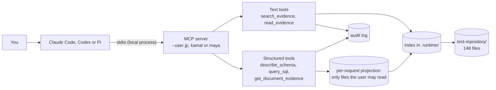

# Install and test the MCP server

This guide is for testers. It tells you how to connect a chat agent to the engineering search, and what to ask. Three clients were tested: **Claude Code**, **Codex** and **Pi**. Any other MCP client that can start a local stdio server works the same way. Each step takes less than five minutes.

The MCP server lets a chat agent answer questions from the documents. It uses the same service, index, permissions and audit log as the web page. The chat client starts the server as a local process on your computer. The server has no network port. It is not exposed to the internet or to other computers. The documents, the index and the audit log stay on your computer. The tool results go to the LLM provider of your chat client.



> **Security hole.** The MCP server does not check who uses it. It searches as the user that the `--user` flag names. Anyone who can edit the client configuration can search as JP and read every file. Use it only with the test documents. [The security hole](#the-security-hole-the-mcp-user-is-not-verified) below gives the details and the fix.

## Two ways to answer a question

The documents hold two kinds of data, and the server gives a way in for each. The chat agent chooses the way from the question. The server instructions tell it how.

| | Unstructured: text | Structured: tables and typed facts |
| --- | --- | --- |
| Good for | One value from prose ("What is the roof load limit at Northgate?"), or "which documents mention…" | Filters, joins and counts over schedules and registers ("Which S355 components have an allowable load under 5 kN/m²?") |
| Data | Passages: sentences, table lines and CSV or sheet rows, with file, page and lines | Table rows from CSV, XLSX and Markdown tables, and typed facts read from them at index time: parameter, value, unit, SI value, role (capacity, demand, specification…), subject, project |
| Who writes the query | The service. It plans the search from the plain-language question | **The LLM in your chat client writes SQL.** The server checks and runs it |
| Tools | `search_evidence`, `read_evidence` | `describe_schema`, `list_tables`, `describe_table`, `query_sql`, `get_document_evidence` |
| Answer | The service picks the answer and gives it a status (`found`, `unverified`, `partial`, `not_found`) | Rows. Each row has `file_id`, `table_no`, `row_no` and `line`, so the agent can cite it |

### The SQL is written by the chat agent, and constrained by the server

For a structured question, the LLM reads the schema with `describe_schema`, writes one SQLite `SELECT`, and sends it to `query_sql`. The server does not trust that SQL. For each call it:

1. Builds an in-memory database that holds **only the rows from files this user may read**. A forbidden file is not filtered out by a `WHERE` clause. It is not in the database at all, so no SQL can reach it, and counts do not include it.
2. Accepts one statement that starts with `SELECT` or `WITH`, at most 4000 characters.
3. Runs it read-only (`PRAGMA query_only`) with an authoriser that allows only reads of the five published tables and views and a list of safe functions. `ATTACH`, `PRAGMA`, writes, `load_extension` and `randomblob` are refused.
4. Stops it after 2,000,000 SQLite steps, and returns at most 500 rows.
5. Writes an audit event: the SHA-256 of the statement, its length, the files in scope, the files excluded by policy, the number of rows and the cited files. It does not write the rows.

`get_document_evidence` then shows the exact row for a citation: the column names, the cells as read, the line, the page or sheet, the typed facts, the file's SHA-256 version and the verbatim line from the file.

What the server cannot check is whether the SQL answers your question. The LLM can write a correct, safe query for the wrong thing, for example compare a capacity with a demand. The tool call shows the SQL, so a tester can read it.

## The security hole: the MCP user is not verified

The MCP server must search as the person who uses the chat client. It does not do that yet.

**What happens now.** The server takes the user from the `--user` flag. Nothing checks the flag. Thus:

- Anyone who can edit the client configuration, or run the command, can select `--user jp` and read every file.
- One server process searches as the same user for every person who uses that client.
- The audit log records the user that the flag names, not the person.
- The project files `.mcp.json` and `.pi/mcp.json` start the server as JP.

The web page has the same weakness, because its sign-in is pretend. But on the web page the choice is visible on the screen. In the MCP configuration it is easy to miss.

The local setup has a second limit. The documents and the index are on the tester's computer. A tester can open the files directly. Thus, in local use, the access rules are a demonstration, not a protection.

**What the fix needs.**

1. Run the MCP server as a remote server (Streamable HTTP transport) on a company server, not on each computer. The documents and the index stay on that server.
2. Protect it with MCP authorization (OAuth 2.1) and the company identity provider. The client signs in the person and sends a token with each request.
3. The server checks the token and takes the user from it. It never takes the user from a flag or a tool argument.
4. The server gets that user's file permissions from the repository, not from `access.py`.
5. The audit log records the verified user.
6. The company approves which document text can go to the LLM provider.

Until then, use the MCP server only with `test-repository/` or with documents that every tester may read.

## How the MCP client and server work

MCP (Model Context Protocol) is a standard way for a chat agent to use tools. There are three parts:

| Part | In this test | What it does |
| --- | --- | --- |
| Host | Claude Code, Codex or Pi | The chat application. It holds the conversation and sends it to the language model (LLM) |
| Client | A connection inside the host, one for each server | It starts the server, and sends tool calls to it |
| Server | `engineering_search.mcp_server` | It gives the tools, and runs them |

When the host starts, it runs the server command, for example `uv run --frozen python -m engineering_search.mcp_server --user jp`. The server is a child process of the host. They send JSON-RPC messages through the standard input and output of that process (stdio). The server indexes the new and changed files, then tells the client its name, its instructions and its tools. The host gives these to the LLM. Each server process searches as one user, the user that `--user` names, for all of its life.

When you ask a question, the LLM decides which tool to call and writes the arguments: a plain-language question for `search_evidence`, or a SQL statement for `query_sql`. The LLM, not you, writes the arguments. The server runs the call and returns JSON. The LLM writes the reply in its own words, and can call more tools.

The server does not see the conversation. It sees only the tool arguments. The LLM sees only what the server returns, and that is only data from files that the user can read.

### The MCP server and the search bar on the web page

| | Search bar (web page) | MCP server (chat agent) |
| --- | --- | --- |
| Who writes the search | You type the question | The LLM writes the tool call from your message |
| Structured questions | Not on the page. `POST /sql` is in the HTTP API | The LLM writes SQL for `query_sql` |
| Process | The web service runs all the time | The chat client starts one process for each server. It stops with the client |
| Connection | HTTP on `127.0.0.1:8000` | stdio between the client and its child process. No port |
| Who the user is | Selected on the sign-in screen (pretend sign-in) | Fixed by `--user` in the client configuration. Not verified |
| Result | The page shows the answer panel and the passages, exactly as returned | The LLM reads the JSON result and writes a reply in its own words |
| Follow-up questions | You select "Ask the next question about these documents only" | The LLM must send the file IDs of the previous list in `within` |
| Where the text goes | Only to your browser | To the LLM provider too, because the LLM must read the result |
| Other functions | Index operations, uploads and the audit log (Maya) | Search, read and SQL. Maya also gets `get_index_coverage` |

Two results of these differences:

- **The reply is not the evidence.** The service controls the tool result. It does not control the reply that the LLM writes. The LLM can shorten, reword or, in a bad case, change a value. The instructions tell it to quote values and cite the source. A tester must compare the reply with the tool result.
- **Permitted text leaves the computer.** A chat agent sends the tool result to the LLM provider. A company must approve this for its documents.

## 1. What you need

| Item | Version | How to check |
| --- | --- | --- |
| Python | 3.11 or later | `python3 --version` |
| uv | any recent version | `uv --version`. To install it, see <https://docs.astral.sh/uv/> |
| One chat client | Tested with Claude Code 2.1.311, Codex CLI 0.162.1 and Pi 1.4.0 | `claude --version`, `codex --version`, `pi --version` |

The install needs network access. After the install, search does not need network access, but your chat client does. The server was tested on macOS. Windows was not tested.

## 2. Get the source and install

Clone the repository, or unzip the source ZIP. Then, in the repository folder:

```bash
uv sync --locked
```

## 3. Check the server before you connect a client

This command starts the MCP server the same way that a chat client does. It lists the tools, asks three text questions and runs the SQL question "S355 components under 5 kN/m²".

```bash
uv run --frozen python -m scripts.check_mcp
```

The first run indexes the 148 files of `test-repository/`. This takes some seconds. The output must end with `The MCP server works.` and show:

- the Northgate roof load limit, 0.6 kN/m², page 2;
- the Northgate building control status, PENDING, page 4;
- a list of 53 documents with a roof load greater than 5 kN/m²;
- 7 S355 rows under 5 kN/m², from the Harbour schedule (CSV), the Harbour roof schedule (XLSX), the Harbour design basis (Markdown table) and the component register (CSV), with the evidence line for the first row.

Do the check again as Kamal. Kamal cannot read the Northgate file or the Harbour roof schedule, so the answers are different: the Northgate questions are not answered, and the SQL returns 6 rows, without R-310.

```bash
uv run --frozen python -m scripts.check_mcp --user kamal
```

If this step fails, go to [Troubleshooting](#7-troubleshooting). Do not continue.

## 4. Connect a client

All three clients start the same command. Run the client in the repository folder, or add `--directory /full/path/to/repository` after `uv run --frozen` so the server finds `test-repository/` and `.runtime/` from any folder.

### Claude Code

The repository has a project configuration, [.mcp.json](../.mcp.json). It starts the server as JP. Start `claude` in the repository folder. Claude Code asks you to approve the project server the first time. Approve it, then check:

```bash
claude mcp list
```

`engineering-search` must show `Connected`. To ask as another user, add a server in the local scope:

```bash
claude mcp add engineering-search-kamal -- uv run --frozen --directory "$PWD" python -m engineering_search.mcp_server --user kamal
```

To ask one question without the interactive session, as was done to verify this guide:

```bash
claude -p "Which S355 components have an allowable load under 5 kN/m²? Cite file and line." --mcp-config .mcp.json --strict-mcp-config --allowedTools "mcp__engineering-search" --max-turns 12
```

In the interactive session, press Ctrl-O to see the tool calls and the SQL.

### Codex

Add the server to your Codex configuration (`~/.codex/config.toml`):

```bash
codex mcp add engineering_search -- uv run --frozen --directory "$PWD" python -m engineering_search.mcp_server --user kamal
```

Then open `~/.codex/config.toml` and add two lines to the new `[mcp_servers.engineering_search]` table:

```toml
startup_timeout_sec = 120
default_tools_approval_mode = "approve"
```

The first start indexes the documents, so the default start timeout can be too short. Without the approval mode, `codex exec` cannot call the tools, because it cannot ask you to approve them. Check with `codex mcp list`.

To ask one question without changing your configuration, as was done to verify this guide:

```bash
codex exec --ephemeral -s read-only -c 'mcp_servers.engineering_search.command="uv"' -c 'mcp_servers.engineering_search.args=["run","--frozen","python","-m","engineering_search.mcp_server","--user","kamal"]' -c 'mcp_servers.engineering_search.startup_timeout_sec=120' -c 'mcp_servers.engineering_search.default_tools_approval_mode="approve"' "Which S355 components have an allowable load under 5 kN/m²? Cite file and line."
```

### Pi

The repository has a project configuration, [.pi/mcp.json](../.pi/mcp.json). It starts the server as JP. Pi reads it only in a trusted project: trust the project when Pi asks, or pass `--approve` for one run. Check:

```bash
pi mcp list
```

To add the server yourself, in the project file (`-l`) or, without `-l`, in `~/.pi/agent/mcp.json`:

```bash
pi mcp add -l engineering-search --description "Engineering documents: cited text search and constrained SQL" -- uv run --frozen python -m engineering_search.mcp_server --user jp
```

To ask one question, as was done to verify this guide:

```bash
pi -p --no-session --no-builtin-tools "Which S355 components have an allowable load under 5 kN/m²? Cite file and line."
```

### Other MCP clients

Any client that starts a local stdio server can use the same command: `uv` with the arguments `run --frozen --directory /full/path/to/repository python -m engineering_search.mcp_server --user jp`. If the client does not use the `PATH` of your terminal (desktop applications often do not), give the full path from `which uv`.

### What was verified

On 29 October 2026, each client answered "Which S355 components have an allowable load under 5 kN/m²?" through this server. Each called `describe_schema`, wrote its own SQL for `query_sql`, and cited rows with `get_document_evidence`.

| Client | User | Rows | Result |
| --- | --- | --- | --- |
| Claude Code 2.1.311 | JP | 7 | All 7 rows, each with file and line |
| Codex CLI 0.162.1 | Kamal | 6 | No R-310: Kamal may not read the roof schedule |
| Pi 1.4.0 | JP | 7 | All 7 rows, each with file and line |

`tests/test_mcp_stdio.py` runs the same check with a real MCP client session over stdio in the test suite.

## 5. Questions to ask

Ask these questions in order. Ask each question as JP first, then as Kamal. The table gives the correct result. Each answer must give the exact text, the file, the page (for a PDF) or sheet, and the lines.

| # | Question | JP (and Maya) | Kamal |
| --- | --- | --- | --- |
| 1 | What is the roof load limit at Northgate? | 0.6 kN/m², Northgate PDF, page 2 | No full match. The closest text (Project Cedar, 5 kN/m²) does not contain "Northgate". The agent must not give it as the Northgate value |
| 2 | Has building control approved the Northgate warehouse? | PENDING, Northgate PDF, page 4 | Not found |
| 3 | What steel is used for the Northgate purlins? | S390GD, Northgate PDF, page 3 | S390GD, from the material approval register PDF, page 1, as `unverified`: the agent must say the cited row does not name every question word |
| 4 | Do we have any documents in Northgate? | 2 documents: the Northgate PDF and the register | 1 document: the register |
| 5 | Of those documents, which mention compliance? | 1 document: the Northgate PDF | None |
| 6 | Which documents specify S355? | 70 documents (Maya: 69) | 66 documents |
| 7 | Which documents have a roof load greater than 5 kN/m²? | 53 documents | 52 documents |
| 8 | What is the fire resistance rating at Northgate? | Not found. No document states it | Not found |
| 9 | Read page 4 of the Northgate PDF | All passages of page 4 | "No readable evidence". The file name and its content do not show |
| 10 | Which S355 components have an allowable load under 5 kN/m²? | 7 rows: B-106, R-310, RG-02, M-401, B-104 (twice: schedule and register), CB-12 | 6 rows: no R-310 |
| 11 | Show me the source row for B-106 | `B-106,Beam,Mezzanine edge,S355J2+N,3.5,,Pending`, Harbour component schedule, line 5 | The same |
| 12 | How many facts come from the Harbour roof schedule? | 15 | 0. The file is not in Kamal's data |

For question 5, the agent must send the file IDs of the list from question 4 in `within`. If the agent searches all documents again, the result is wrong.

Questions 10 to 12 must use `query_sql`. For question 10, rows not returned are correct: B-105 (6.0), R-311 (5.2) and CB-14 (5.6) are over the limit, R-312 is S460, F-021 is an imposed load (a demand, not a capacity), and R-313 is a formula with no saved value.

Also try your own questions. Ask in plain language. You do not need to know file names, formats, table names or columns.

### What to look for

- **The answer comes from a document.** The value must be in the quoted text or the cited row. The agent must not calculate or guess a value.
- **The source is exact.** Ask the agent for the file, page or sheet, and line. The values are in the tool result.
- **Kamal never gets Northgate, specification or roof schedule content.** If Kamal gets text, a file name, a row or a count from `project-northgate/`, `specifications/` or `project-harbour/harbour-roof-schedule.xlsx`, report it at once. That is a serious defect.
- **"Not found" is correct when no document states the value.**
- **The SQL asks for the right thing.** Read the SQL in the tool call. It must compare `allowable_load_kn_m2` (a capacity), not `imposed_load_kn_m2` (a demand). It must match grades with `LIKE 'S355%'`, so S355J2 and S355J2+N count.
- **The quoted text answers the question.** For text answers, `found` is a word check, not a check of the value. Report any answer whose quoted text is about a different element.
- **The agent's reply matches the tool result.** Nothing checks this. Report a reply that changes a value or a row count, or presents a `partial`, `unverified` or `not_found` result as a fact.
- **Speed.** Each tool call must take less than 10 seconds. Most take less than 0.1 seconds.

### What to report

For each problem, send:

1. The client, the user and the exact question.
2. What the agent said, and what you expected.
3. The tool calls and results, if you can see them, including the SQL.
4. The `request_id` from a text result. The index team can find the call in the audit log with it.

## 6. The tools

| Tool | Input | Returns |
| --- | --- | --- |
| `search_evidence` | question, mode (`auto`, `answer`, `list`), `within`, limit, page | The answer and its status, or a list of documents (at most 200 per page), and the supporting passages |
| `read_evidence` | file_id, page | All indexed passages of a file or of one PDF page |
| `describe_schema` | none | The tables and views that `query_sql` can read, with notes on units and citations. No document data |
| `list_tables` | none | The table and view names |
| `describe_table` | table | The columns, with type, meaning and units |
| `query_sql` | sql, limit (1 to 500) | columns, rows, row_count, truncated, or an error that says why the statement was refused |
| `get_document_evidence` | file_id, table_no, row_no | The cited row: columns, cells, line, page or sheet, typed facts, SHA-256 file version and the verbatim line |
| `get_index_coverage` | gaps_limit | Index team (Maya) only. Files by type and status, the readers, and the files not fully read, with the reason |

### Example SQL

The chat agent writes its own SQL. These examples show what the schema supports, with the results on `test-repository/`. `tests/test_sql.py` runs each one.

The published tables are `documents`, `facts`, `components` (a view), `table_rows` and `source_tables`. Call `describe_table` for the columns.

**A number filter and a grade match.** S355 covers S355, S355J2 and S355J2+N.

```sql
SELECT subject, material_grade, allowable_load_kn_m2, file_id, line
FROM components
WHERE material_grade LIKE 'S355%' AND allowable_load_kn_m2 < 5
ORDER BY allowable_load_kn_m2
```

JP: 7 rows, from 3.5 (B-106) to 4.8 (CB-12) kN/m². Kamal: 6 rows, no R-310.

**A compliance status for one project.**

```sql
SELECT subject, compliance_status, file_id, line
FROM components
WHERE project = 'Harbour' AND compliance_status <> 'Approved'
ORDER BY file_id, line
```

JP: B-106 (Pending, schedule line 5) and R-313 (Pending, roof schedule line 5). Kamal: B-106 only.

**A join by source row.** Each fact and each component row names its table and row, so the agent can get the original cells.

```sql
SELECT c.subject, c.allowable_load_kn_m2, r.cells_json, c.file_id, c.line
FROM components c
JOIN table_rows r ON r.file_id = c.file_id AND r.table_no = c.table_no AND r.row_no = c.row_no
WHERE c.subject = 'B-106'
```

One row: 3.5, with the cells `["B-106", "Beam", "Mezzanine edge", "S355J2+N", "3.5", "", "Pending"]`, schedule line 5.

**A count by project.**

```sql
SELECT project, count(DISTINCT file_id) AS files, count(*) AS facts
FROM facts GROUP BY project ORDER BY project
```

JP: Harbour 5 files and 48 facts (3 of them from the title block of the DXF drawing), Cedar 1 and 6, Riverside 1 and 3, and 121 files with no project (the generated test files). Kamal: Harbour 4 and 33, because the roof schedule is not in Kamal's data.

**A demand, not a capacity.** An imposed load is what a component must carry, not what it can carry. Do not compare it with an allowable load.

```sql
SELECT subject, imposed_load_kn_m2, file_id, line
FROM components WHERE imposed_load_kn_m2 IS NOT NULL
```

JP: 6 rows (F-021, F-022 and R-310 to R-313). Kamal: 2 rows (F-021, F-022).

**No rows is a correct answer.** Units are normalised, intent is not: "under 5 N/m²" is 0.005 kN/m², and no S355 component is that low.

```sql
SELECT subject, file_id FROM components
WHERE material_grade LIKE 'S355%' AND allowable_load_kn_m2 < 0.005
```

No rows, for every user.

## 7. Troubleshooting

| Problem | Cause and fix |
| --- | --- |
| `check_mcp` fails with `No module named ...` | The install did not run. Run `uv sync --locked` in the repository folder |
| Claude Code does not show `engineering-search` | Claude Code was started outside the repository folder, or the project server was not approved. Start `claude` in the folder and approve it, or use `--mcp-config .mcp.json` |
| `claude mcp list` shows `Failed to connect` | The server cannot start. Copy the command from `claude mcp get <name>` and run it in a terminal. Read the error |
| Codex says the tool call was cancelled or not approved | `codex exec` cannot ask for approval. Set `default_tools_approval_mode = "approve"` for the server |
| Codex says the server did not start in time | The first start indexes the documents. Set `startup_timeout_sec = 120` |
| Pi does not list the server | The project is not trusted, so Pi does not read `.pi/mcp.json`. Trust it, pass `--approve`, or add the server to `~/.pi/agent/mcp.json` |
| `spawn uv ENOENT` or `command not found: uv` | The client cannot find `uv`. Use the full path from `which uv` as the command |
| `query_sql` returns an error | The statement was refused: not one `SELECT`, too long, a forbidden table or function, or over the step budget. The error says which. The agent can correct the SQL and try again |
| A tool returns `"busy": true` | The server cannot answer within the 8 s budget, so it refused the call at once. Ask again after `retry_after_seconds`. Over stdio each client has its own server, so this is rare; a long SQL projection or a slow machine can cause it. `SEARCH_BUDGET_SECONDS` sets the budget ([ADR 0018](adr/0018-admission-control-and-the-time-budget.md)) |
| The first question is slow | The server indexes new and changed files when it starts. The next start hashes every file and extracts only the changed files |
| Index refresh fails with 503 at start | The document folder is missing, or a folder in it cannot be read. Check `--documents` |
| A warning about pydantic shows in the log | The warning is harmless. The server writes it to stderr, not to the MCP channel |
| Results look out of date | Delete `.runtime/index-*.sqlite3`. The server makes the index again at the next start |

To see the tools without a chat client, use the MCP Inspector. It needs Node.js.

```bash
npx @modelcontextprotocol/inspector uv run --frozen python -m engineering_search.mcp_server --user jp
```

## 8. Use your own documents

Add `--documents` and `--state-dir` to the server arguments. Use full paths.

```bash
claude mcp add my-documents -- uv run --frozen --directory "$PWD" python -m engineering_search.mcp_server --user jp --documents /full/path/to/documents --state-dir /full/path/to/state
```

The server reads `.md`, `.pdf` (text layer only, no OCR), `.csv` and `.xlsx` files. It detects the type from the file content; the extension is a hint. Tables in CSV, XLSX and Markdown files become rows and typed facts for `query_sql`. Facts are not read from prose, so a value stated only in a sentence is found by `search_evidence`, not by SQL. Scans and CAD files are listed in the coverage report, not read.

The access rules in `engineering_search/access.py` apply to your files too. If no rule matches a path, all three users can read the file.

## 9. Limits

- `--user` selects whose permissions apply, and nothing verifies it. This is a security hole. See [The security hole](#the-security-hole-the-mcp-user-is-not-verified).
- The server runs on your computer only (stdio). There is no remote MCP server yet. ChatGPT and GitHub Copilot were not tested.
- The LLM writes the SQL. The server makes it safe; it does not make it right. Read the SQL. The 13 gold questions in [evaluation/sql_questions.json](../evaluation/sql_questions.json) are the planned measure; no client has been scored on them yet ([ADR 0019](adr/0019-evaluate-retrieval-and-nl-to-sql.md)).
- Each call is answered within 8 s or refused at once with `"busy": true` and `retry_after_seconds`.
- The web service and the MCP server can use the same `.runtime/` folder. They then share the index and the audit log. Index builds take a file lock, so they do not run at the same time.
- [RUNNING.md](../RUNNING.md) tells you how to run the web page. [ARCHITECTURE.md](../ARCHITECTURE.md) tells you how a question is answered.
